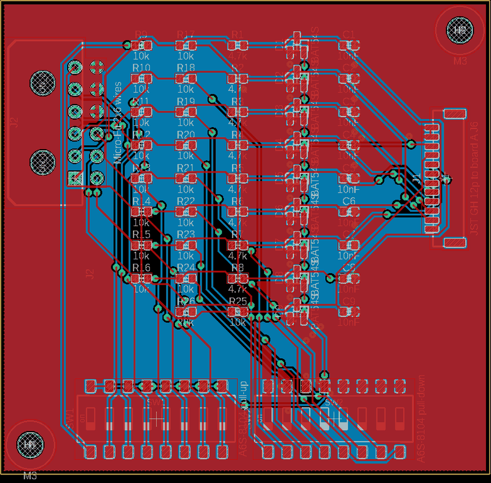

# Fusion Electronics check - board A, board B, input board

Job fusionelec, 2026-11-23. Boards from main 19479b5 (the PCBs are byte-identical on de6c419; drcclean only changed
schematic waivers / IDs). Fusion 2706.1.17 (trial, Ultimate, ends 2026-12-01). Every number below came from a tool run;
the scripts are in `tools/fusion_check/` (registered in `automation.yml` as `fusion-electronics-check`), the raw Fusion
reports in `docs/fusion-check/`.

## Re-check after PR #142 / #148 (job fusion2, 2026-11-23)

Boards changed since the first check: A (PR #142 op-amp ties, #148 FRAM U5), B (#148 FRAM U5), input board (#148 DIP
switches -> solder jumpers JP1-JP16, re-routed). Hardware on main a422adf = the files imported (SHA-256 equal). Re-imported
to Fusion folder `electronics-2026-11-23b` (board-A / board-B / input-board, v1 each; the 2026-11-23 folder untouched).

| Item (KiCad / Fusion) | Board A | Board B | Input board |
|---|---|---|---|
| Parts | 145 / 145 | 211 / 211 | 64 / 64 (was 50: 2 DIP switches -> 16 jumpers) |
| Nets with 2+ pads (split / merged / pins missing) | 116 / 116 (0 / 0 / 0; was 113: the 3 op-amp ties) | 139 / 139 (0 / 0 / 0) | 36 / 36 (0 / 0 / 0) |
| Pads | 528 / 517 (same 11 paste-only openings) | 798 / 755 (same 43) | 159 / 159 |
| Vias | 328 / 328 (was 325) | 678 / 678 | 117 / 117 (was 136) |
| Copper layers, outline | 4 / 4, 72.39 x 95.25 mm | 4 / 4, 111.39 x 95.25 mm | 2 / 2, 66.0 x 64.0 mm |

Fusion DRC (JLC rules) and ERC, what changed against section 3 / 4 (raw lists `docs/fusion-check/drc-*.txt`, `erc-*.txt`):

| Change | Board | Class | Why |
|---|---|---|---|
| ERC "uninvoked op-amp gates with unconnected inputs" U7 A, U12 A / B: 6 -> 0 | A | real defect fixed | PR #142 ties them as followers (ADR-2026-11-23-tlv-unused). |
| Copper clearance 55 -> 59 (new at U12 pins 2-5 and U7 pin 3) | A | rule artefact | New GND tie vias / tracks; KiCad gap 0.205-0.255 mm (> class 0.2 mm, > JLC 0.09 mm), Fusion reads the TSSOP pads tighter. |
| Air wires 8 -> 11 (U7 pins 11-12, U12 pins 10-12) | A | import artefact | The tie track runs across the adjacent GND pin; KiCad: 0 unconnected, parity 0. |
| Overlap 50 -> 192, copper clearance 0 -> 69, all at JP1-JP16 (+ same-net vias in pads) | IN | import artefact | KiCad `SolderJumper-2_P1.3mm_Open_RoundedPad1.0x1.5mm` custom-shape pads become several overlapping Fusion pads (as JP1 / JP3 on A and B). Real pad-to-pad gap 0.305 mm (KiCad shapes), JLC 2-layer 0.10 mm; KiCad DRC 0. |
| ERC input board: 64 info items only (FOOTPRINT not found, sync off) | IN | import artefact | as section 4 |
| Board B | B | unchanged | Same counts and items as section 3 / 4 (U5 is a part swap in the same footprint). |

**Real defects from the re-check: none new; the one known (floating op-amp inputs) is gone.** Wire-stub warnings no longer
appear in this Fusion build's DRC output. Fusion heat cross-check: `docs/fusion-thermal-check.md` (it replaces section 5).

## For Dan (plain English)

1. **All three boards came into Fusion whole.** Same parts, same connections, same 4 / 4 / 2 copper layers, same outline.
   The only things Fusion drops are 11 (A) / 43 (B) paste-only stencil openings that have no copper: they are in the
   KiCad Gerbers we send to JLCPCB, so nothing is lost for the order.
2. **Fusion's own rule checks found no new real defect.** Every Fusion DRC / ERC item is one of: something we already
   know and ordered for (vias in pads, filled and capped), the maker's USB-C pattern, a rule Fusion copied from KiCad's
   project settings, or a side effect of the translation (Fusion re-pours the copper fills and reads track joins its own
   way). The one real item, board A's 3 unused op-amp channels with floating inputs, was already found by KiCad and the
   drcclean job; its fix is on branch `fix/tlv-unused` (board A needs this check re-run after it merges).
3. **Fusion heat study: run later by job fusion2** with the copper heating lumped in as extra heat sources:
   `docs/fusion-thermal-check.md`.

## 1. What was imported, where

Fusion project `custom-pdm`, folder `electronics-2026-11-23` (the old `board-A-2026-11-11`, `board-B-2026-11-11`,
`input-board` folders are untouched). Import = Fusion's KiCad importer (API `DataFolder.uploadFile` of the
`.kicad_pro`, "ECAD Design Upload Options": Sheets, Create Electronics Design; one click on OK per board, done by the
agent with screen control, DECISIONS 2026-11-08). Uploaded from a scratch copy of `hardware/` (nothing written back).

| Board | Fusion subfolder | Designs (v1) |
|---|---|---|
| A | `electronics-2026-11-23/board-A` | `DingoPDM` .fprj / .fsch / .fbrd |
| B | `electronics-2026-11-23/board-B` | `dingoPDM-Max` .fprj / .fsch / .fbrd |
| Input | `electronics-2026-11-23/input-board` | `input-board` .fprj / .fsch / .fbrd |

File formats: the PCBs are KiCad 9 (`20241229`), the schematics KiCad 10 (`20260306`). No KiCad 9 save-as copy was
needed: the nets came through (section 2). The KiCad 10 problem in `hardware.md` is the PCB file (PR #3: a KiCad 10
`.kicad_pcb` lost every net); Fusion reads KiCad 10 schematics. Fusion shows "Schematic/PCB sync deactivated" on every
import (the importer does not link the two), which is why the ERC lists every part as "FOOTPRINT not found in board".

## 2. Translation check (Fusion ULP `brdinfo.ulp` vs KiCad 9 pcbnew `kicad_ref.py`, compared by `compare2.py`)

Nets are compared by their pin sets, not by name (Fusion renames KiCad's hierarchical and auto nets: `/MCU/CAN_TX` ->
`MCU_CAN_TX`, `Net-(U8-IS)` -> `N$nn`; KiCad pads that share a number in one footprint get `_1`, `_2` ... suffixes).

| Item | Board A KiCad / Fusion | Board B KiCad / Fusion | Input KiCad / Fusion |
|---|---|---|---|
| Parts | 145 / 145 (same references) | 211 / 211 | 50 / 50 |
| Nets with 2+ pads | 113 / 113 (0 split, 0 merged, 0 pins missing) | 139 / 139 (0 / 0 / 0) | 36 / 36 (0 / 0 / 0) |
| Extra 1-pin signals in Fusion | 5 (`MCU_SWO_UNUSED` + 4 unnamed single pads) | 6 | 0 |
| Named nets kept by name | 59 of 64 (rest: hierarchical renames) | 66 of 75 | 36 of 36 (leading `/` dropped) |
| Pads | 528 / 517 | 798 / 755 | 159 / 159 |
| Pad difference | 11 paste-only openings (no copper, no number): D2 4, U21 3, D26 2, D27 2 | 43 paste-only: T1-T8 4 each, D2 4, U27 3, D29 2, D30 2 | none |
| Vias | 325 / 325 | 678 / 678 | 136 / 136 |
| Copper layers | 4 / 4 (Top, Route2, Route63, Bottom) | 4 / 4 | 2 / 2 |
| Outline (edge to edge) | 72.39 x 95.25 mm / same (KiCad's 72.44 x 95.30 includes the 0.05 mm line) | 111.39 x 95.25 mm / same | 66.0 x 64.0 mm / same (0.1 mm line) |

**Translation differences that matter: none.** Fusion also copies KiCad's net class "Default" (track 0.2 mm, via drill
0.4 mm, clearance 0.2 mm; B 0.2032 mm) into its net class 0, and does not copy KiCad's zone priorities: both show up in
the DRC below. Info: the KiCad stackup says 1.77 mm (upstream's dielectrics, kept on purpose by `tools/pcb_stackup.py`);
JLCPCB builds its own 1.6 mm (order checklist), so the board STEP is 0.17 mm thicker than the real board.

## 3. Fusion DRC with JLCPCB rules (`jlc4.dru` / `jlc2.dru`, from `mkdru.py`)

Rules = the JLCPCB limits in `tools/gen_fab_jlcpcb.py` (`JLC_LIMITS`): 4-layer track / clearance 0.09 mm (2-layer
0.10), SMD-SMD 0.15, hole 0.15, hole to hole 0.2, copper to edge 0.2, annular ring PTH 0.15 (2-layer 0.18) and via 0.05
(fixed, no drill-percentage), copper 35 um on all layers, dielectric 0.21 / 1.065 / 0.21 mm (1.6 mm board; 2-layer
1.53 mm). Fusion's net class 0 (copied from KiCad, see 2) still applies on top.

| Fusion DRC item | A | B | IN | Class | Why |
|---|---|---|---|---|---|
| Overlap (via in / touching an SMD pad, same net) | 66 | 168 | 50 | known, covered | The via-in-pad vias (58 / 151 / 27, `verify_dfm.py`); ordered Epoxy Filled & Capped (order checklist, fab notes). |
| Overlap (solder jumper pads JP1 / JP3 (A), JP1 / JP2 (B), and pads touching pads of one footprint) | 21 | 30 | 0 | import artefact | KiCad's custom-shape jumper pads become several overlapping Fusion pads. KiCad DRC: 0. |
| Copper clearance at USB-C J5 (A) / J2 (B) | 40 | 40 | - | known (maker pattern) | GCT USB4085: 0.15 mm gaps (drcclean group 8); Fusion's oval-pad translation reads them tighter. JLC check passes. |
| Copper clearance elsewhere | 15 | 123 (67 at U4) | 0 | rule artefact | Net class 0 = KiCad's 0.2 / 0.2032 mm clearance: LQFP U4 pins at 0.5 mm pitch have a 0.2 mm gap (B fails 0.2032 by 3 um, same as drcclean group 9); the rest are Fusion's re-poured fills. KiCad DRC at the same rules: 0 active. |
| Copper width | 0 | 101 | 0 | rule artefact | The 101 tracks of 0.2 mm vs the 0.2032 mm class width (the same 101 KiCad tracks, drcclean group 9). JLCPCB: 0.09 mm. |
| Drill size | 5 | 4 | 0 | rule artefact | 0.3 mm vias (U21 / U27 pad, FB1, D26) vs the class via drill 0.4 mm. JLCPCB: 0.15 mm. |
| Clearance (polygons with same rank) | 25 | 37 | 0 | import artefact | KiCad zone priorities (PF_OUT pours at J3 / T1-T8) are not copied; KiCad fills them in order. |
| Component exclude clearance (courtyards) | 25 | 42 | 0 | known + artefact | Around the DNP 5 V modules U14 (A) / U12 (B) next to U21 / U27 and its caps (KiCad courtyard items, waived by drcclean), the press-fit terminals, J1 / H1; the rest are Fusion's own keep-out shapes. |
| Annular ring | 6 | 22 | 8 | import artefact | Non-plated holes (Tag-Connect J4 / J5, REDCUBE T1-T8 centre holes, J2 / H1 / H2 on the input board) become pads with no ring. |
| Air wires (unrouted; items / wire pieces) | 8 / 8 | 12 / 25 | 0 | import artefact | Joints KiCad makes by copper overlap: a track that runs across a pad without ending on it (e.g. B C66.1 / C67.1 +12P, U22 pins 1-2) or a pad that joins its fill only by KiCad's own pour. KiCad: 0 unconnected, parity 0. Fusion only counts a track end or its own pour. |
| Wire stubs (warning) | 10 | 35 | 0 | import artefact | Track ends that sit off a pad centre or under a via; electrically joined in KiCad. |

Totals: A 221, B 614, input board 58 (raw lists in `docs/fusion-check/drc-*.txt`). **Real defects from the Fusion DRC: none.**

## 4. Fusion ERC (schematics)

| Fusion ERC item | A | B | IN | Class |
|---|---|---|---|---|
| Attribute FOOTPRINT not found in board (info) | 145 | 209 | 50 | import artefact (sync deactivated, section 1) |
| More than one OUTPUT pin on PF_OUTn | 24 | 72 | 0 | false alarm: PROFET output pins of one channel tied, as the data sheets require (drcclean group 3) |
| SUPPLY pin overwritten (regulator outputs, VCAP_1, DNP 5 V modules on +5VP) | 10 | 10 | 0 | false alarm (drcclean groups 4-6) |
| POWER pin connected to ... (info) | 31 | 39 | 0 | information only |
| Missing junction / segment with no visual connection | 11 | 14 | 0 | cosmetic (KiCad wire drawing; connectivity matches, section 2) |
| Only input pins / one pin on MCU_SWO_UNUSED | 2 | 0 | 0 | intentional (drcclean group 7) |
| **Uninvoked op-amp gates with unconnected inputs: U7 A, U12 A and B** | 6 | 0 | 0 | **real (small, known)**: 3 unused TLV9004 channels on board A float; KiCad `missing_unit` shows the same; fix on `fix/tlv-unused` |

## 5. Fusion thermal cross-check: not run here (superseded: run by job fusion2, `docs/fusion-thermal-check.md`)

- Licence (Fusion MCP `licensing`, 2026-11-23): trial, Simulation extension active until 2026-12-01, no Flex tokens.
  Autodesk: Fusion solves Thermal and Electronics Cooling studies only in the cloud; without the Simulation Extension they
  cost 3 / 6 tokens each (help: "Tokens for simulation studies"). So today a solve would cost no tokens, but only for 8 days.
- Not run because it would not be a cross-check of the same physics: a Fusion Electronics Cooling study takes heat per
  body (chip) and a board-level copper description; it cannot apply the current-driven I^2R heating of the +12 V feed
  and output copper (board B: 9.1 W at 150 A, `docs/pcb-verification.md`), which is what limits board B in
  `thermal_board_b.py` and the Elmer model. It also needs a 3D PCB and a study set up through the experimental `adsk.sim`
  API or by hand. DECISIONS 2026-11-08 (Dan) also says "No Fusion thermal study".
- If the coordinator still wants a chip-only check (driver losses + sink at 70.9 / 74.5 C, `docs/heat-analysis.md`,
  fans on), it must be run before 2026-12-01 while the trial extension is active.

## How to re-run

1. Upload: Fusion Data Panel or API `uploadFile` of each `.kicad_pro` (scratch copy), Sheets, OK.
2. Open each `.fbrd`; Fusion text command `Electron.run "RUN tools/fusion_check/brdinfo.ulp <out>.txt"` and
   `geo.ulp`; `DRC LOAD tools/fusion_check/jlc4.dru` (`jlc2.dru` for the input board; Fusion asks "use these settings
   anyway?" (same-signal clearance note): Yes), `DRC`, `RUN errs.ulp <out>.txt`; on each `.fsch`: `ERC`, `RUN errs.ulp`.
3. `"%LOCALAPPDATA%\Programs\KiCad\9.0\bin\python.exe" tools/fusion_check/kicad_ref.py ref.json`, then
   `compare2.py ref.json A|B|IN <brdinfo out>`, `classify.py <errs out> <geo out> <out.json>`, `ercsum.py <erc out>`.

## Build package exports: .f3z, .f3d, STEP, EAGLE (job pkgfix, 2026-11-24)

Dan (2026-11-24): "find a way to actually export the f3z". What was tried, in order (Fusion 2706, trial):

| Way | Result |
|---|---|
| API `ExportManager.createFusionArchiveExportOptions(<name>.f3z)` on the 3D PCB design | writes `<name>.f3z.f3d`: the 3D PCB has no external references, so Fusion's archive of it is an .f3d (the File > Export dialog of the 3D PCB lists .f3d only, no .f3z) |
| API `DataFile.download` / `dataObject` | refused for Fusion data ("Only DataFiles that represent non-Fusion data can be downloaded", API reference) |
| Data panel "Export Archive" (`CopyToDesktopCommand`) on the Electronics design | writes an `.fprj` only (1.4 MB, the design container; no schematic or board inside) |
| Fusion Compute MCP (cloud Fusion) | its APS app lists only Assets, Standard Components and Default Project in hub dgrip (not `custom-pdm`), and its export modes are STL / STEP / OBJ / SVF: no .f3z |
| Fusion Data / APS Data Management MCP | none available in this session |
| **File > Export of the opened Electronics design** (the `.fprj` tab active), type "Autodesk Fusion Archive Files (*.f3z)" | **works**: a cloud translation writes `<name>.f3z` holding the `.fprj`, `.fsch` and `.fbrd` (Autodesk support article "How to export the entire folder/files of an Electronics Design to local disk in Autodesk Fusion"). Re-uploading the .f3z gives the linked design back. |

The catch: before an .f3z export Fusion saves a new version of every design with pending changes ("The design has
pending changes. A new change will be saved before exporting"), and opening an imported design always marks the
board changed. So the package job does not export from the checked folder `electronics-2026-11-23b` (that would
add versions to it). It imports the same KiCad files again into its own folder and exports from there:

1. `tools/fusion_check/export_package.py` (run inside Fusion under the fusion-desktop lock): `upload()` of each
   `.kicad_pro` into `custom-pdm/electronics-<date>-pkg/<board>` (click OK on "ECAD Design Upload Options": Sheets,
   Create Electronics Design), `open_design()`, `run_ulp(brdinfo.ulp)` for the counts, `export_3d()` for
   `<board>-3D-PCB.f3d` + `.step` (API), `close_all()` (never saves).
2. By hand or with screen control, with the design's tabs open: `.fprj` tab: File > Export, type .f3z, Export (wait
   for the Job Status line "Complete"); schematic tab: File > Export, "EAGLE 9.X Compatible Schematic Files (*.sch)";
   board tab: File > Export, "EAGLE 9.X Compatible Board Files (*.brd)". Fusion has no API for these three.

Run 2026-11-24 (folder `electronics-2026-11-24-pkg`, imported from branch `feat/build-package-2`, hardware equal to
`main` after PR #164 apart from the input board J2 3D model path, which the Fusion importer does not use: the
input board 3D PCB has the same STEP size as before):

| Board | brdinfo.ulp (elements / signals / vias) | .f3z content | Same as KiCad (section "Re-check") |
|---|---|---|---|
| A | 145 / 121 / 328 | `.fprj` + `.fsch` + `.fbrd`, 2.0 MB | yes |
| B | 211 / 145 / 678 | same, 2.8 MB | yes |
| Input | 64 / 36 / 117 | same, 0.5 MB | yes |

The 3D PCB is not part of the .f3z (Fusion makes it from the board on demand); the package carries it as the
separate `.f3d` and `.step`. In Fusion's 3D PCB the input board J2 is still Fusion's own package body, not the
Molex STEP (that one is in the KiCad project and the KiCad board STEP).
