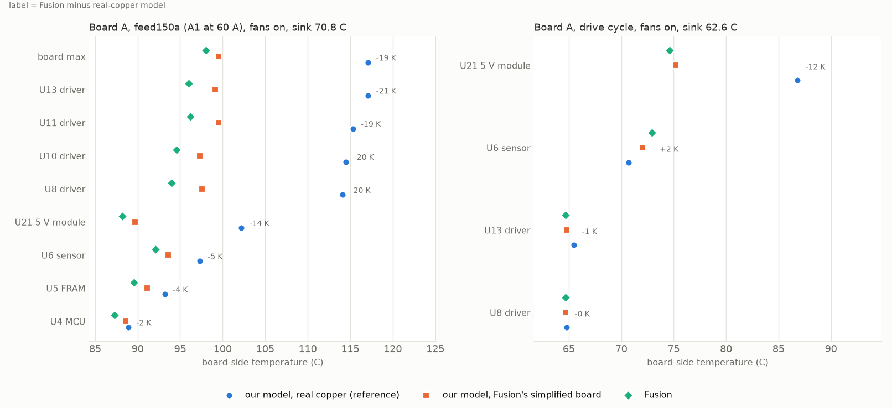
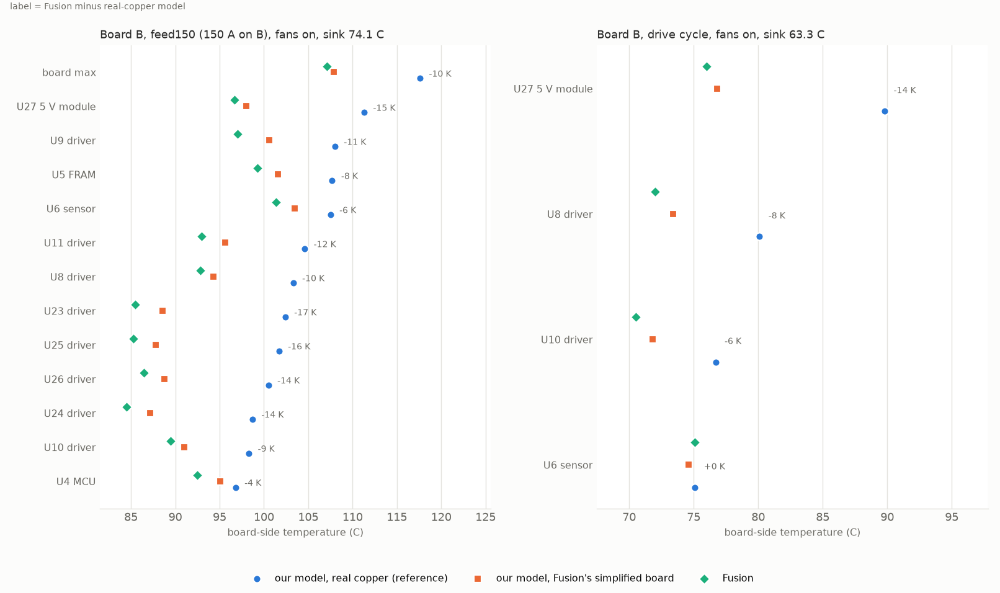
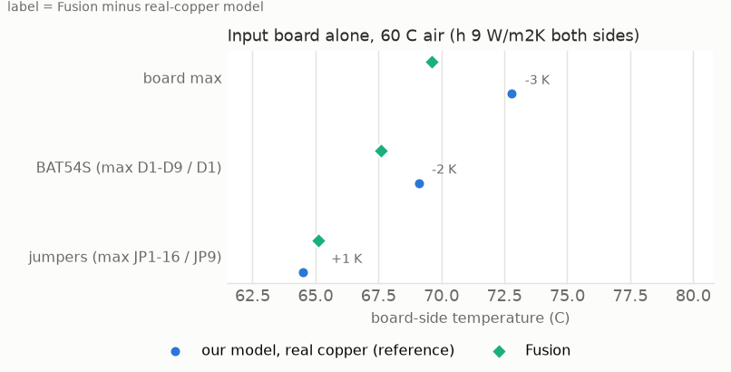
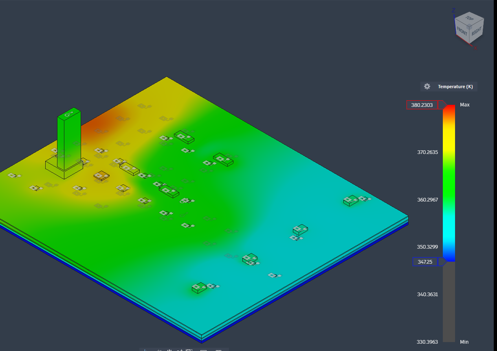

# Fusion thermal cross-check - board A, board B, input board

Job fusion2, 2026-11-23 (ADR-2026-11-23-fusion-check). Fusion 2706.1.17, trial with the Simulation extension (ends
2026-12-01). Licence checked first (Fusion MCP `licensing`): trial, Simulation active, no Flex token account. Every
solve ran in Autodesk's cloud on the trial: **0 Flex tokens spent.** Numbers below are from tool runs; data in
`docs/fusion-check/thermal-compare.json`, charts `docs/diagrams/fusion-thermal-{A,B,IN}.png`.

## For Dan (plain English)

1. **Fusion's solver agrees with ours.** Given the same simplified board, Fusion and our board model differ by
   0-3.6 K at every hot spot of every case (Fusion slightly cooler). So the heat inputs, the sink / gap-pad / air
   boundaries and the physics are the same in both tools.
2. **Fusion cannot hold the real copper.** Fusion's study stalls (its automatic contact search ran over 15 min on 16
   bodies), so the Fusion boards are a few simple layers: each copper pair is one smeared sheet, the vias are spread out,
   the copper I2R heat is lumped into 10 mm tiles. On that board every hot spot reads cooler than on the real copper.
3. **So: does Fusion agree with the Elmer-chain numbers within 10 K? Not everywhere.** It agrees within 10 K for the
   input board, the U6 sensor, MCU, FRAM and the light (drive-cycle) drivers. It reads 10-21 K cooler at the loaded
   drivers and 12-15 K cooler at the 5 V modules. Our own model, run on Fusion's simplified board, shows the same drop
   (row "lite" below), so the gap is the simplified board, not a disagreement about the heat.
4. **Nothing in Fusion is hotter than our model** (worst: U6 on board A drive cycle, +2.2 K, still 31 K under its
   cut). Our real-copper model stays the hotter, conservative number; the order numbers in `docs/heat-analysis.md` stand.
5. **Full assembly in Fusion: not run.** The per-board step had to agree within 10 K first (ADR-2026-11-23-fusion-check)
   and it does not on the real copper; the revF box (155 parts) is far past what Fusion's contact search handled here.
   The box stays Elmer only.

## 1. Fusion vs Elmer chain, per hot spot (C, board side; drivers = board top under the exposed pad)

real = `tools/thermal_a.py` / `thermal_board_b.py` / `thermal_input.py` on the real KiCad copper, sink at the Elmer box
temperature (the numbers in `docs/heat-analysis.md`); lite = the same model on Fusion's simplified board
(`tools/fusion_thermal/smeared_check.py`); Fusion = point probe in the solved Fusion study.

| Case | Hot spot | real | lite | Fusion | Fusion - real | Fusion - lite |
|---|---|---|---|---|---|---|
| A feed150a (A1 60 A, sink 70.8) | board max | 117.1 | 99.5 | 98.0 | **-19.1** | -1.5 |
| | U13 driver (hottest) | 117.1 | 99.1 | 96.0 | **-21.1** | -3.1 |
| | U8 / U10 / U11 drivers | 114.1 / 114.5 / 115.3 | 97.6 / 97.3 / 99.5 | 94.0 / 94.6 / 96.2 | **-20.1 / -19.9 / -19.1** | -3.6 / -2.7 / -3.3 |
| | U21 5 V module | 102.2 | 89.7 | 88.2 | **-14.0** | -1.5 |
| | U6 sensor / U5 FRAM / U4 MCU | 97.3 / 93.2 / 88.9 | 93.6 / 91.1 / 88.6 | 92.1 / 89.6 / 87.3 | -5.2 / -3.6 / -1.6 | -1.5 / -1.5 / -1.3 |
| A drive (sink 62.6) | U21 5 V module | 86.8 | 75.2 | 74.6 | **-12.2** | -0.6 |
| | U6 / U13 / U8 | 70.7 / 65.5 / 64.8 | 72.0 / 64.8 / 64.7 | 72.9 / 64.7 / 64.7 | +2.2 / -0.8 / -0.1 | +0.9 / -0.1 / 0.0 |
| B feed150 (150 A on B, sink 74.1) | board max (feed corner) | 117.6 | 107.9 | 107.1 | **-10.5** | -0.8 |
| | U27 5 V module | 111.3 | 98.0 | 96.7 | **-14.6** | -1.3 |
| | U9 / U11 / U8 / U10 drivers | 108.0 / 104.6 / 103.3 / 98.3 | 100.6 / 95.6 / 94.3 / 91.0 | 97.0 / 93.0 / 92.8 / 89.5 | **-11.0 / -11.6 / -10.5** / -8.8 | -3.6 / -2.6 / -1.5 / -1.5 |
| | U23-U26 drivers | 102.4 / 98.7 / 101.7 / 100.5 | 88.6 / 87.2 / 87.8 / 88.8 | 85.5 / 84.5 / 85.3 / 86.5 | **-16.9 / -14.2 / -16.4 / -14.0** | -3.1 / -2.7 / -2.5 / -2.3 |
| | U5 FRAM / U6 / U4 MCU | 107.7 / 107.5 / 96.8 | 101.6 / 103.5 / 95.1 | 99.3 / 101.4 / 92.5 | -8.4 / -6.1 / -4.3 | -2.3 / -2.1 / -2.6 |
| B drive (sink 63.3) | U27 5 V module | 89.8 | 76.8 | 76.0 | **-13.8** | -0.8 |
| | U8 / U10 / U6 | 80.1 / 76.7 / 75.1 | 73.4 / 71.8 / 74.6 | 72.0 / 70.5 / 75.1 | -8.1 / -6.2 / 0.0 | -1.4 / -1.3 / +0.5 |
| Input board in60 (60 C air) | board max | 72.8 | - | 69.6 | -3.2 | - |
| | BAT54S (max D1-D9 / D1) | 69.1 | - | 67.6 | -1.5 | - |
| | jumpers (max JP1-16 / JP9) | 64.5 | - | 65.1 | +0.6 | - |

Bold = more than 10 K apart. Tj = board + P x RthJC is the same add-on in both tools, so the Tj gap equals the board gap.
B feed150 U4 probe 0.5 mm off the part centre. Input board: one-sheet model, so no lite run.

## 2. Why the differences over 10 K

- **Copper smeared into sheets** (biggest part): a driver's exposed pad sits on its own +12 V copper island; on the real
  board its heat must cross that island's necks and its vias before it spreads. In Fusion's sheet every bit of copper of
  every net joins in. Our model with only this change (smeared) drops U13 on A feed150a from 117.1 to 105.0 C and the B
  laminate max from 117.6 to 110.1 C (`smeared_check.py`).
- **Layer pairs merged, vias spread evenly** (the rest of the lite board): drops U13 a further 6 K to 99.1 C.
- **5 V modules**: their 0.131 W sits on a 3.8 x 3 mm part on the real board; Fusion spreads it into a 10 mm heat tile,
  so their spot is 12-15 K cooler. The lite run (heat placed as the real board) gets the same smear from the copper.
- What is left between Fusion and lite (0-3.6 K, Fusion cooler) is the 10 mm heat tiles and Fusion's mesh (parabolic
  tetrahedra, 10 % size, about 0.45 M nodes).

## 3. How the Fusion models were built and checked

- `tools/fusion_thermal/export_board.py` runs the board model's own case and writes the lite board (sheet / core / via
  patch conductivities, heat tiles, chips, J1 + BATT bar, gap pads TGP 3000 k 3 0.86 mm on the pedestals, air as h,
  sink temperature) and the reference; `build_fusion_board.py` builds it in Fusion (Fusion MCP, folder
  `electronics-2026-11-23b/thermal`: `thermal-A-feed150a`, `-A-drive`, `-B-feed150`, `-B-drive`, `-IN-in60-lite4`);
  loads set in Fusion's Thermal Loads dialog (`sim_select.py`; the `adsk.sim` preview API returns no simulation for these
  documents in this build); `probe_points.py` gives the probe coordinates.
- Loads checked from Fusion's own study report: A feed150a applied temperature 343.95 K (70.8 C sink) and 358.95 K
  (bar, sink + 15 K), internal heat 0.1415 W/mm3 = 11.21 W = the model's 7.2 W drivers + 3.73 W copper + 0.29 W J1;
  A drive 335.75 / 350.75 K, 0.0087 W/mm3 = 0.35 W. Mesh about 0.45 M nodes / 0.25 M parabolic elements.
- Fusion's reported minimum is below the sink (A feed150a 49.5 C vs 70.8 C): an overshoot of the parabolic elements in
  the very thin, low-k "air" slabs, away from every probed point; the plates and probes read as expected.

## 4. How to re-run

1. `"%LOCALAPPDATA%\Programs\KiCad\9.0\bin\python.exe" tools/fusion_thermal/export_board.py A feed150a --json <out>`
   (A drive, B feed150, B drive, IN in60 the same).
2. Fusion MCP script: `build_fusion_board.build(<out>, <doc name>, ["custom-pdm", "electronics-2026-11-23b", "thermal"])`;
   in Fusion: Simulation > Thermal study, loads with `sim_select.pick` + the Thermal Loads dialog, solve on the cloud
   (no tokens while the Simulation extension is active; check `licensing` first, stop if a solve would cost tokens).
3. `python tools/fusion_thermal/probe_points.py <out> <q>`, point probes in Fusion, values into
   `docs/fusion-check/thermal-compare.json`.
4. `"%LOCALAPPDATA%\Programs\KiCad\9.0\bin\python.exe" tools/fusion_thermal/smeared_check.py A feed150a` (lite column),
   then `python tools/fusion_thermal/plot_compare.py`.
