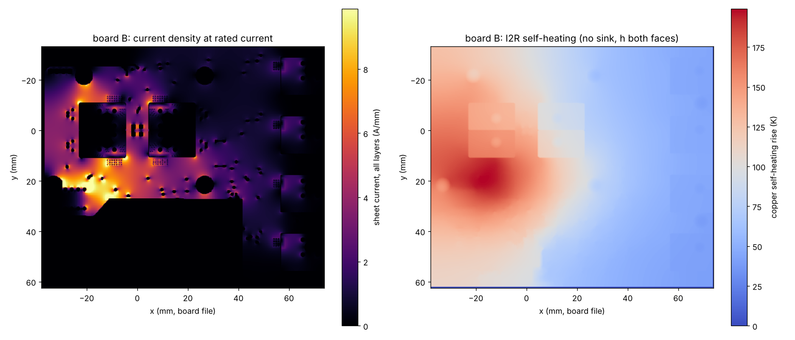
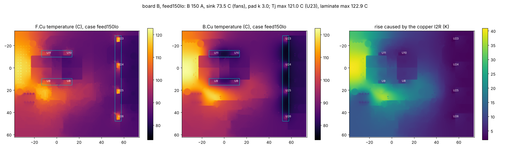

# PCB verification - board A, board B, input board (automated, no human layout look)

Job pcbverify, 2026-11-20 (DECISIONS 2026-11-17: automated checks replace Dan's look at the layouts). Every row was
produced by a tool run; the command is in the Evidence column and in `automation.yml` (`pcb-verify-*`).
Results, not decisions: the choices this asks for are listed under "Left" and go to the coordinator.

## For Dan (plain English)

1. **Board A (x2) and the input board: OK to order.** **Board B: its +12 V copper is fixed in layout (hwfix, 2026-11-20)**: more copper on two inner layers and 135 extra vias; in a heat model with the heat sink, the gap pad and the lid it now stays at 123 C or less at the 150 A feed limit with the fans on (was 165 C; limit 130 C). Still above the limit only with every output at full rating at once (184 A, more than the feed allows) or at 150 A with the fans off: the firmware's 150 A cap and thermal limit cover those.
2. **Fixed today:** the JLCPCB placement file would have put 8 parts in turned the wrong way (3.3 V regulator on A and B, 4 connectors, 2 DIP switches) and 3 part types off-centre (USB socket, 5 V module, wire connector); and the +12 V copper on the bottom of A and B came within 0.1 mm of the aluminium posts under the screws (now 0.6 mm clear).
3. **Fixed 2026-11-20 (hwfix):** the current-sense amplifier is now rail-to-rail (TLV9004): board A reads to about 15 A, hot or cold, and every switch fault reads 3.28 V, above the firmware's 2.475 V fault level, with a 5.1 V clamp diode. **Left (coordinator):** the input surge diode: the part that survives the alternator's 35 V load dump (SM8S24CA, a larger package) does not fit where the diode sits now without moving it (or two parts next to it).
4. Everything else passed: rule checks (KiCad, JLCPCB limits, holes), output copper (2-5 mV drop per output), 3.3 V start-up, CAN, USB, inputs.
5. Not checkable here: Fusion's own ERC / DRC (the Fusion MCP add-in was not connected on DansPC today); KiCad + JLCPCB-rule checks cover the same rules.

## Tools and how to re-run

| Tool | What it checks | Run (repo root) |
|---|---|---|
| `kicad-cli` 10.0.7 (DansPC) | ERC, DRC all categories + schematic parity | `kicad-cli pcb drc --schematic-parity --severity-all --format json ...`, `kicad-cli sch erc --severity-all ...` (stock baselines 542b3b9 / fe19c28 run the same way) |
| `tools/gen_fab_jlcpcb.py` | DRC with JLCPCB's limits only, drilled-hole overlap check, zone refill check, fab outputs | KiCad 9 python: `python tools/gen_fab_jlcpcb.py` -> `hardware/fab/*/jlcpcb-drc.txt` |
| `tools/verify_copper.py` (new) | DC current density, IR drop, I^2R, via currents, copper self-heating, on the real copper polygons (finite-volume network, 0.1 mm cells, 0.2 mm for the feed; grid-checked 0.1 / 0.15 / 0.2 / 0.3 mm: loss within 0.7 %) | KiCad 9 python + scipy: `python tools/verify_copper.py A B [--outer-um 35 --inner-um 17.5] [--plots docs/diagrams]` |
| `tools/verify_spice.py` (new) | ngspice: current sense -> ADC, TVS vs ISO 7637-2 / ISO 16750-2, 3V3 start-up, input board, CAN termination | `python3 tools/verify_spice.py` (Linux / cloud: ngspice 42; DansPC needs an ngspice build, none installed) |
| `tools/thermal_board_b.py` (hwfix) | board B steady heat on the real copper of all 4 layers + vias: driver and copper I^2R (hot-copper rho), joints, gap pad on the sink pedestals, 4 mm air gap, lid air, J1 terminal + BATT bar; sink temperature from the enclosure model (`docs/enclosure-v2c.md` 4); grid-checked 0.3 / 0.25 mm: 0.2 K | KiCad 9 python + scipy: `python tools/thermal_board_b.py [--case ...] [--air fans|nofan] [--kpad 3] [--res 0.3]` |
| `tools/board_semdiff.py` (hwfix) | content diff of a rebuilt board against main: footprints / pads / nets, tracks and vias, zones | `python tools/board_semdiff.py <old> <new>` |
| `tools/verify_layout.py` (new) | CAN / USB pairs, crystal, I2C rise time, decoupling distance, metal at mounting holes, solid joints on power pads, mask dams, fiducials, board B vs stock | KiCad 9 python: `python tools/verify_layout.py --stock-b <stock dingoPDM-Max.kicad_pcb>` |
| `tools/verify_cpl.py` (new) | the "JLC preview" check: every placed part's LCSC footprint (JLCEDA / EasyEDA official library, https://easyeda.com, https://lceda.cn) turned by the CPL rotation must land on our pads | `python tools/verify_cpl.py` (needs easyeda.com; it answers 403 from DansPC, works from the cloud session) |

Copper: the boards' stackup says 43.2 um outer / 17.3 um inner; the JLCPCB default order (1 oz outer finished about 35 um, 0.5 oz inner) is run as well (`--outer-um 35 --inner-um 17.5`). Copper weight is Dan's choice (not set by agents).

## Board A (dingoPDM v7.5 based, built twice): 18 PASS, 1 FAIL (TVS), 3 WARN, 1 not checkable, 1 info (rows)

| Check | Tool | Result | Evidence | Action |
|---|---|---|---|---|
| KiCad DRC, all categories | kicad-cli 10 DRC | 0 unconnected; errors only in stock patterns: 56 clearance + 20 annular (USB-C J5 GCT USB4085 footprint, 0.15 mm ring = JLCPCB's limit), 4 courtyard (J1/H1 terminal beside its hole, U14/U15/C4 alternate regulators (only U15 fitted, BOM checked), JP1/U2), 6 starved thermal (1-spoke GND reliefs on 0805 passives). Same or fewer than the stock board 542b3b9 in every type. PASS | DRC json (DansPC %TEMP%\pv), `tools/drc_diff.py` vs stock | none |
| Schematic parity | kicad-cli 10 | 4 field notes ('Datasheet' '~' vs ''), no net / part mismatch. PASS | DRC json | cosmetic, none |
| KiCad ERC | kicad-cli 10 ERC | 30 errors, all pin-type artefacts: PROFET output pins tied (16), alternate 5 V modules on one rail (2, one fitted), LDO tab (1), power-in pins fed through resistors / ferrite (9), NRST + unused SWO input pin (2). Stock: 37. PASS | ERC json | none |
| JLCPCB limits + holes | gen_fab_jlcpcb.py | 0 violations; co-located holes 0; refill change 0.000 %. PASS | `hardware/fab/board-a/jlcpcb-drc.txt` | none |
| Fusion ERC / DRC | Fusion MCP | not checkable: add-in not connected (DansPC device info: autodesk-fusion-mcp failed) | - | re-run when Fusion is up |
| PF_OUT1-8, 7.5 A each | verify_copper | drop 2.0-2.6 mV, 15-20 mW each, peak 4.4 A/mm at the driver pins; 1 oz: 2.4-3.1 mV. PASS | `verify_copper.py A` | none |
| +12V feed, 60 A (8 x 7.5 A) | verify_copper | J1 to the farthest driver 41 mV (1 oz: 50 mV), I^2R 2.2 W (1 oz: 2.7 W); hot spot 8.5 K over the board mean (1 oz: 11.7 K, limit 10 K, no-sink model). PASS (1 oz: marginal) | same | add the copper I^2R to the heat model (below) |
| Vias | verify_copper | worst 2.05 A in one +12V via at U13; barrel self-heating < 0.2 K (fin model); 1 via over the long-trace IPC-2221 chart. PASS | same | none |
| Current sense -> ADC, BTS7008 | verify_spice | was FAIL (LM2902: clips at 8.2 A at 25 C / 5.9 A hot). FIXED 2026-11-20: TLV9004IPWR (rail-to-rail) + PDZ5.1B clamp: reading 5 % low only from 15.7 A (rating 7.5 A), at -40 / 25 / 125 C and in both zener corners; at rating 1.651 V, 0.823 V under the firmware fault level 2.475 V (PROFET_IS_FULL_SCALE 3071, reached at 11.2 A = 1.50 x rating); a fault (IIS(FAULT) 4.4 mA min) reads 3.280 V (4070 counts), +0.805 V over the level, at every corner. PASS | `verify_spice.py` (is_*) | done (docs/parts-audit.md 14.1 / 14.2) |
| kILIS constant | verify_spice | firmware 5450 = data-sheet typical (+-4 %; PR #112, was 5950): reading at rating +0.0 %. PASS | same, docs/parts-audit.md | none |
| IS saturation 15 mA into the chain | verify_spice | PDZ5.1B holds 5.14-5.19 V; TLV9004 input current 0.25-0.34 mA (abs max 10 mA, its input diodes); ADC pin 3.28 V (<= 3.6 V), -40 / 25 / 125 C. PASS | same | none |
| TVS D2 5.0SMDJ24CA | verify_spice | pulse 2a 33.5-34.9 V (<= 35 V VBAT(LD)) PASS; 3a / 3b absorbed by the caps PASS; pulse 1 -29.6 / -31.9 V vs the static reverse rating -16 V WARN (GND-VS breakdown then up to 0.29-0.34 A through the fitted RGND 47R for the 2 ms; no pulse rating in the data sheets); ISO 16750-2 load dump B (35 V, Ri 0.5 / 2 / 4 Ohm, 400 ms): 12-123 J vs about 7 J FAIL. Candidates (`--tvs`): SM8S24CA (DO-218AB) PASS everywhere except pulse 1 WARN (load dump 31-327 W vs 622 W derated rating, 2a 32.4-34.0 V); 5.0SMDJ33CA (DO-214AB, Infineon's DZ2) stays off in the load dump but clamps 2a at 44-46 V FAIL | same (tvs_*) | Left 2: SM8S24CA does not fit at D2 (parts-audit 14.3) |
| 3V3 start-up | verify_spice | monotonic, max 3.298 V, 3.0 V at 1.96 ms. PASS | same | none |
| CAN pair | verify_layout | 21.5 / 19.9 mm, electrically short (critical 1.2 m at 1 Mbit/s); termination stub 2.9 mm; jumper JP3 open. PASS | `verify_layout.py` | keep every PDM CAN_TERM jumper open (SPICE: a third 120R drops the dominant level to 1.38 V < 1.5 V) |
| USB pair | verify_layout | 42.8 / 43.2 mm, short for full speed (critical 100 mm). PASS | same | none |
| Crystal Y1 | verify_layout | 7.7 mm to the OSC pins, nothing routed under it PASS; no ground plane under it: stock all-layer keep-out WARN | same | none (stock design) |
| I2C pull-ups | verify_layout | 10k, estimated rise 304-306 ns at 400 kHz (limit 300 ns) WARN | same, `port.h` i2cConfig 400000 | Left 5 |
| Decoupling | verify_layout | CAN transceiver U3 VDD (+5V) has no local cap (nearest 69 mm, as stock); LDO U2 caps 7-9 mm; op-amps 4.3-4.4 mm. WARN | same | Left 5 |
| Metal at mounting holes | verify_layout | was +0.11 mm from the 6.0 mm aluminium sink post (enclosure `build_v2b.py` BOSS) to the +12V pour: FIXED by `tools/pcb_hole_keepout.py` (pour keep-out r 3.6 mm, F.Cu / B.Cu): now +0.61 mm (IPC-2221B B2 31-50 V: 0.6 mm); +3V3 track at H1 +0.23 mm (0-15 V: 0.1 mm). PASS | same; DRC unchanged (214) | done |
| Power pads solid to pours | verify_layout | 0 thermal-relief joints on +12V / PF_OUT. PASS | same | none |
| Mask dams < 0.10 mm | verify_layout | 0. PASS | same | none |
| Silk over pads | kicad-cli DRC | 4 silk_over_copper + 2 silk_edge warnings (stock); JLCPCB clips silk off pads | DRC json | none |
| Fiducials | verify_layout | none; JLCPCB adds rails with fiducials and tooling holes when it panelises. INFO | same | none |
| CPL polarity / rotation | verify_cpl | was 2 FAIL: U2 SOT-223 (TLV1117LV, C15578) turned 90 deg, J6 JST GH turned 180 deg; centre offsets J5 USB-C 3.7 mm, U15 TSR 2.5 mm. FIXED in `gen_fab_jlcpcb.py` (rotation table checked part by part, new OFFSETS). Now 121 of 121 placements land on their pads. PASS | `verify_cpl.py`; `board-a-cpl-jlcpcb.csv` | done |

## Board B (dingoPDM-Max based): 12 PASS, 1 FAIL (TVS), 1 WARN, 1 not checkable, 1 info (rows)

| Check | Tool | Result | Evidence | Action |
|---|---|---|---|---|
| KiCad DRC, all categories | kicad-cli 10 DRC | 0 unconnected; errors: 20 annular + 56 hole clearance (USB-C J2 footprint, stock), 101 track width + 7 clearance (stock IS / MCU tracks at 0.15-0.2 mm, above JLCPCB's 0.09 mm), 10 courtyard (4 stock + 6 new: U8-U11 vs T1-T4 and T1/T3, T2/T4: the bodies stay 2.3 mm apart, only the courtyard margins touch), 10 starved thermal (GND), 1 BOOT label size. All other types equal to or fewer than stock fe19c28. PASS | DRC json, `drc_diff.py` | none |
| Schematic parity | kicad-cli 10 | 4 'Datasheet' field notes. PASS | DRC json | none |
| KiCad ERC | kicad-cli 10 | 81 errors, same pin-type artefacts as A (+19 pin-to-pin / +4 power-pin from the four added BTS7004; stock 58). PASS | ERC json | none |
| JLCPCB limits + holes | gen_fab_jlcpcb.py | 0 violations, 0 co-located holes. PASS | `hardware/fab/board-b/jlcpcb-drc.txt` | none |
| Fusion ERC / DRC | Fusion MCP | not checkable (add-in not connected) | - | re-run when Fusion is up |
| PF_OUT1-4, 31 A each | verify_copper | 2.1 mV, 65 mW each, 23 vias each, worst via 1.5 A. PASS | `verify_copper.py B` | none |
| PF_OUT5-8, 15 A each | verify_copper | 4.8 mV, 72 mW each (F.Cu carries it: the inner / bottom pours of these nets have no vias at the driver, only the terminal holes join them). PASS | same | none |
| +12V feed | verify_copper / thermal_board_b | was FAIL (B.Cu only: 184 A 143 mV / 19.9 W, 150 A 117 mV / 13.3 W; in the sink model 163-165 C at 150 A, limit 130 C). FIXED 2026-11-20 by `tools/pcb_feed_board_b.py` (In2 +12V pour over the board, In1 +12V band over the J1 corridor with GND channels for D14 / D16, B.Cu +12V edge moved into the +3V3 pour, 135 stitching vias; no part moved): 150 A 82 mV / 9.1 W, 184 A 100 mV / 13.6 W (20 C copper). Heat model, fans on, gap pad k 3: 150 A laminate max 122.7-124.3 C (3 splits), Tj max 110.5-121.0 C; car load (118 A, car-loads.dummy.md) 109.9 C / Tj 114.2 C. PASS at the 150 A feed limit. Every output at rating (184 A): 157.5 C FAIL (above the feed limit: firmware cap). Fans off (wall): 150 A 138.6-140.1 C FAIL, car load 120.7 C PASS | `thermal_board_b.py --res 0.3` (`--air nofan`) | firmware keeps the 150 A cap; fans-off full load needs the thermal limit (e3c) |
| Vias | verify_copper | worst 4.9 A in a via under a BTS70012 pad (the EP via array carries 31 A); barrel self-heating 0.5 K (fin model); 28 over the long-trace chart. PASS | same | none |
| Current sense -> ADC | verify_spice | TLV9004 + PDZ5.1B: BTS70012 reads to 97 A (5 % low; rating 31 A), BTS7004 to 57.5 A (15 A), -40..125 C, both zener corners; at rating 1.104 / 0.900 V, 1.371 / 1.575 V under the 2.475 V fault level (reached at 69.5 / 41.2 A); faults read 3.280 V (+0.805 V); kILIS fw 33700 / 20000 = typical (PR #112). PASS | `verify_spice.py` | none |
| TVS D2 | verify_spice | as board A: load dump B FAIL, pulse 1 WARN; SM8S24CA passes but does not fit (same D2 spot as A) | same | Left 2 |
| 3V3 start-up, CAN, USB, crystal, I2C, decoupling | verify_spice / verify_layout | as board A: start-up, CAN (stub 15.8 mm), USB PASS; crystal keep-out, I2C 10k, no cap at U3 VDD, U22 op-amp cap 8.5 mm WARN | same | Left 5 |
| Metal at mounting holes H1-H6 | verify_layout | FIXED (keep-out stage): +12V +0.61 mm from the sink post, +3V3 +0.23 mm at H1. PASS | same | done |
| Power pads, mask dams, fiducials | verify_layout | 0 / 0 / none (INFO). PASS | same | none |
| CPL polarity / rotation | verify_cpl | was 2 FAIL: U2 SOT-223 turned 90 deg, J7 JST GH vertical 180 deg; J2 USB-C 3.7 mm and U13 TSR 2.5 mm off centre: FIXED. Now 186 of 186 (T1-T8: no LCSC part, pad pattern the same at every 90 deg; 8 x 47 nF caps: no library footprint, 2-pad). PASS | `verify_cpl.py` | done |
| Board B vs stock dingoPDM-Max | verify_layout | 73 parts added (the BTS7004 rail U23-U26 + IS / buffer parts, T1-T8 terminals, H5 / H6, J6 / J7, JP2), 10 removed (test points TP1-TP8, J4, logo G1), 1 moved (logo G2), 7 value changes (each in DECISIONS: TVS, Schottky, LDO, CAN transceiver, MCU suffix, FRAM, op-amp). Power copper: +12V pour 3296 -> 5588 mm2 and vias 85 -> 133; OUT1-4 pours 193 -> 174 mm2 and vias 25 -> 23 per output (changed since stock), checked above. INFO | same | none |

## Input board: 5 PASS, 0 FAIL, 2 WARN (rows)

| Check | Tool | Result | Evidence | Action |
|---|---|---|---|---|
| KiCad DRC / ERC | kicad-cli 10 | 0 errors (50 + 100 library-path warnings), 0 unconnected, parity 0. PASS | DRC / ERC json | none |
| JLCPCB limits + holes | gen_fab_jlcpcb.py | 0 violations. PASS | `hardware/fab/input-board/jlcpcb-drc.txt` | none |
| Digital input (4.7k, BAT54S, 10 nF) | verify_spice | 14.4 V in -> 3.44-3.55 V at the pin (VIH 2.31 V); 0 V / -1 V offset -> 0.02 / -0.18 V. PASS | `verify_spice.py` (din_*) | none |
| Current pushed into +3V3 | verify_spice | 8 inputs at 14.4 V push 27 mA into board A's +3V3 (the LDO cannot sink): fine while the MCU runs (40-60 mA), the rail can rise if the board sleeps with inputs high. WARN | same | Left 4 |
| Analog input (10k / 20k) | verify_spice | 5.00 V reads 4.994 / 4.928 / 4.848 V at 25 / 85 / 125 C (BAT54S leakage). PASS to 85 C, WARN at 125 C | same | none |
| Mounting holes, mask dams | verify_layout | GND only near H1 / H2 (switch pull-up 2.1 mm away); 0 dams. PASS | `verify_layout.py IN` | none |
| CPL polarity / rotation | verify_cpl | was 4 FAIL: J1 JST GH turned 180, J2 Micro-Fit 180 (+7.6 mm off centre), SW1 / SW2 DIP switches 90 deg: FIXED. Now 48 of 48. PASS | `verify_cpl.py` | done |

## Fixes made (generators only; no footprint, pad, net or terminal moved)

- `tools/gen_fab_jlcpcb.py`: JLCPCB rotation table corrected part by part (SOT-223 180 -> 270, JST GH SM horizontal 180 -> 0; new: JST GH BM vertical 180, Molex Micro-Fit 43045 180, Omron A6S DIP 270) and a centre-offset table (USB-C GCT USB4085, Traco TSR-1, Micro-Fit 43045-1200). CPL files regenerated: 4 rows on A, 4 on B, 4 on the input board.
- `tools/pcb_hole_keepout.py` (new last stage of `build_board_a.ps1` / `build_board_b.ps1`): copper-pour keep-out r 3.6 mm on F.Cu / B.Cu around every mounting hole. Boards A and B refilled, Gerbers F_Cu / B_Cu regenerated. DRC counts unchanged; +12V drop +0.6 mV (A) / +3.6 mV (B).

## Left (for the coordinator; technical choices, data above)

1. ~~Board B +12V copper~~ FIXED in layout 2026-11-20 (ADR-2026-11-20-boardb-feed, hwfix): see the +12V feed row; copper weight unchanged. Open: the 150 A firmware cap must stay; with the fans off a full 150 A load runs the corridor to about 140 C (thermal limit e3c).
2. **TVS D2 vs suppressed load dump** (FAIL, open): the part that passes is Vishay SM8S24CAHM3/I (DO-218AB, bidirectional, AEC-Q101; SPICE above; docs/parts-audit.md 14.3). It does not fit at D2 (7.6 mm free across, needs about 11.5 mm): either D2 moves to a free spot (A about (24.9, -12.5 .. 8.5), B about (36-39, -14 .. -9)) with new copper to +12V / GND, or C2 / J1 move; it is about 5 mm tall (lid). Not changed: a footprint / part move needs the coordinator and the enclosure job first. Infineon's own 33 V TVS (5.0SMDJ33CA, same footprint) avoids the load-dump energy but lets pulse 2a reach 44-46 V.
3. ~~Current-sense buffer~~ FIXED 2026-11-20 (ADR-2026-11-20-is-buffer): TLV9004IPWR; the IS clamp zeners are PDZ5.1B (a PDZ3.3B at its data-sheet limits holds a fault at 2.31 V when hot, under the 2.475 V fault level).
4. Input board current into +3V3 while the board sleeps with inputs high (WARN): check against the sleep current, or a 3.6 V clamp / bleed on +3V3.
5. Small, stock-inherited: no 100 nF at the CAN transceiver VDD (MCP2562FD data sheet asks for one); I2C pull-ups 10k at 400 kHz are at the 300 ns edge (4.7k would give about 150 ns).

## Copper loss for the heat model

`docs/heat-analysis.md` counts only the driver losses (31.1 W worst case). The copper adds, at every output at its rating, 2 x 2.2 W (A1, A2) + 13.6 W (B since the 2026-11-20 feed fix; 19.9 W before) + output pours 0.13 W (A) / 0.55 W (B): about 19 W more (25 W before the board B fix; stackup copper). At the 150 A feed limit it is about 0.24 x that (I^2), about 6-13 W depending on how the 150 A splits.
