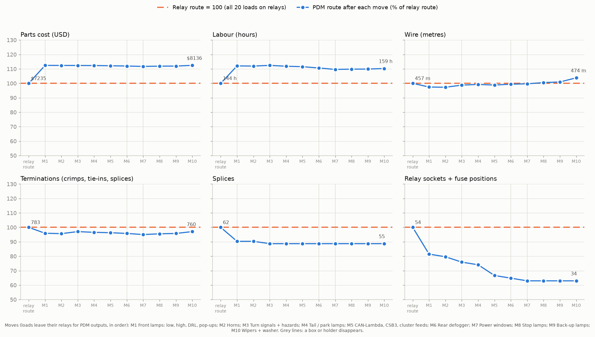

# PDM or relays for the ST185: is the PDM worth it? (harness cost study, harnesscost, 2026-11-23)

Dan's brief (2026-11-23 08:54-08:56): find the point where the PDM drastically cuts the length and the work of the
current harness plans. Every relay is new or from the on-hand list (the OEM relays are too old or too small). All
wiring is covered in Raychem DR-25 with moulded boots and transitions. Count labour, wire, crimping, tools, box
builds and install on both routes. The ECU's loads (fuel pump, EPS, both fans, heater, A/C, ETB, pedal, boost,
injectors, coils) and K-EFI stay on relays and count the same on both routes (ADR-2026-11-23-ecu-loads).

Numbers come from `tools/harness_cost_study.py`. Its outputs: `docs/harness-cost/*.dummy.csv` and the chart
`docs/diagrams/harness-breakpoint.png`. It reads st185-link-ecu-config @ e047a17, read only. Prices are USD.
**ASSUMED** marks a figure with no quote or source behind it. The earlier, smaller estimate is kept at the end as the
"first estimate".

## Verdict (for the board-order go / no-go, c7 = a)

- **Harness savings do not justify the board order on their own. At no point does the PDM drastically cut length or
  work.** Its best point is after move M7 (14 of the 20 loads moved), compared with the relay route:
  - Wire: about the same (455 m vs 457 m, -0.3 %).
  - Terminations: 39 fewer (-5 %). Splices: 7 fewer (-11 %).
  - Relay sockets + fuse positions: 34 vs 54 (-37 %). Four relay holders and the flasher are gone.
  - Parts: **+$848 (+12 %)**. Labour: **+13.9 h (+10 %)**.
- **Why it can't be drastic:** st185 already puts the relays in the glove box, right where the PDM would sit. The long
  runs (lamps, horns, pop-up motors, wipers) exist on both routes. The PDM only swaps the short box wiring (coil
  feeds, fuse jumpers, relay pigtails) for input wires that run back to the switches.
- **Moves M8-M10 only add wire** (stop, back-up, wipers / washer: +19 m, +16 terminations). Those loads have no
  relay today. Move them only for the features (fault reading, intermittent wipe, wash-wipe).
- **What the PDM does change a lot:** box parts and fault-finding. Relay sockets drop from 23 to 10 and fuse
  positions from 31 to 24. Gone: RLY-DRL, the R8 retract relay and its replacement, the flasher, the taillight relay,
  the defogger relay and the power main relay. Gone from LOGIC: 6 of 9 relays and 7 of 20 fuses. Added: per-output
  current reading and logic in software (section (c) of the first estimate below).
- **For the order decision:** treat this study as **neutral to negative**. Decide the order on the product goal (an
  open-source PDM, the 2026-11-16 goal) and on the proof and assembly-options reports. Don't count on the harness to
  pay for it. If the boards are ordered: move M1-M7. M8-M10 are optional.

## Totals per route

Relay route = the st185 harness, the POWER / LOGIC / BATTRELAY boxes as designed, and new relays where st185 keeps an
OEM one. PDM route = all 10 moves done (20 loads on the PDM).

| | Relay route | PDM route (all moves) | Best PDM point (after M7) |
|---|---|---|---|
| Parts cost | **$7,235** | **$8,136** | $8,083 |
| Labour | **144.1 h** | **158.9 h** | 158.0 h |
| Parts + labour at $35 / h (ASSUMED value) | $12,279 | $13,698 | $13,613 |
| Wire | 456.8 m (458 wires) | 474.3 m (438 wires) | 455.3 m (430 wires) |
| Terminations (crimps, tie-ins, solder joints, splices) | 783 | 760 | 744 |
| Splices | 62 | 55 | 55 |
| Harness connectors (each with a boot) | 61 | 63 (adds X1, X2) | 63 |
| Relay sockets / fuse positions | 23 / 31 | 10 / 24 | 10 / 24 |
| Branch points (layout nodes with 3+ legs) | 71 | 71 | 71 |
| DR-25 tubing | 52.6 m, 190 pieces, $677 | 52.4 m, 189 pieces, $683 | 52.4 m, $662 |
| Moulded transitions | 49 | 50 | 50 |

Wire per gauge, relay route vs PDM route (m): 20 AWG 213.8 vs 259.4, 18 AWG 70.1 vs 51.7, 16 AWG 49.6 vs 39.6,
14 AWG 39.6 vs 44.3, 12 AWG 12.4 vs 6.3, 10 AWG 18.7 vs 18.4, 8 AWG 7.5 vs 7.5, 6 AWG 2.3 vs 4.4 (PDM feed and ground),
4 / 2 / 1/0 AWG and the shielded cables are the same on both routes (`docs/harness-cost/routes.dummy.csv`).

Where the money goes (relay route vs PDM route):

| Cost line | Relay | PDM |
|---|---|---|
| Wire and cable | $1,219 | $1,244 |
| st185 harness BOM: connectors, contacts, seals, splices (same both routes) | $1,113 | $1,113 |
| Moulded transitions + epoxy | $2,576 | $2,576 |
| Boots (adhesive lined) | $901 | $901 |
| DR-25 | $677 | $683 |
| Fuse boxes POWER / LOGIC / BATTRELAY (st185 parts lists) | $573 | $546 |
| Relays, holders, new terminations / the PDM (boards $750 mid, enclosure $140, rest) | $175 | $1,072 |

Labour (h, relay vs PDM): cut, strip, mark 7.6 vs 7.3. Terminate 33.5 vs 31.9. DR-25 19.3 vs 19.2. Boots and
transitions 14.7 vs 14.8. Route and install 26.0 vs 26.3. Test 3.1 vs 2.9. Build the st185 boxes 34.8 vs 34.0.
Relays, holders, design and the PDM build 5.1 vs 22.6. The PDM line is: inside-box wiring 8.9 h (111 wires,
`harness/enclosure-wire-list.csv`), mechanical assembly 4 h, design of the harness changes 4 h and setup 5 h (all
ASSUMED), and mounting 0.5 h.

## The breakpoint (moves in order)

Each move takes loads off their relays and puts them on PDM outputs (`docs/st185-car-config.dummy.md`). The PDM is
built once, with the first move (the enclosure holds all three boards). The order puts the moves that remove relays
first.

| Move | Loads (car config #) | Parts | Hours | Wire m | Terminations | Relays / fuses | Boxes or holders gone |
|---|---|---|---|---|---|---|---|
| relay route | - | $7,235 | 144.1 | 456.8 | 783 | 23 / 31 | - |
| M1 Front lamps: low, high, DRL, pop-ups | 1 2 3 12 13 | $8,134 | 161.5 | 445.2 | 751 | 16 / 28 | **RLY-DRL holder (B5); R8 and its new 2-relay holder; POWER AMI OUT-2 (RTR 30 A)**; LOGIC 4 relays + 3 fuses |
| M2 Horns | 5 | $8,132 | 161.4 | 444.4 | 749 | 15 / 28 | LOGIC K-HORN |
| M3 Turn + hazards | 9 11 | $8,130 | 162.0 | 451.3 | 760 | 14 / 27 | **flasher**; LOGIC HZ fuse |
| M4 Tail / park | 14 15 | $8,127 | 161.2 | 453.4 | 756 | 13 / 27 | taillight relay |
| M5 CAN-Lambda, CSB3, cluster | 21 7 8 | $8,116 | 160.7 | 451.4 | 754 | 12 / 24 | LOGIC K-ON + 3 fuses |
| M6 Rear defogger | 20 | $8,101 | 159.4 | 454.1 | 750 | 11 / 24 | defogger relay; **relay holder B1** |
| M7 Power windows | 17 | **$8,083** | **158.0** | **455.3** | **744** | **10 / 24** | power main relay; **relay holder B2** |
| M8 Stop lamps | 4 | $8,097 | 158.3 | 459.2 | 748 | 10 / 24 | - (adds wire) |
| M9 Back-up lamps | 22 | $8,100 | 158.4 | 461.2 | 750 | 10 / 24 | - (adds wire) |
| M10 Wipers + washer | 23 24 16 | $8,136 | 158.9 | 474.3 | 760 | 10 / 24 | - (adds wire) |

The chart shows each measure as % of the relay route. Cost and hours jump about 12 % at M1 (the PDM's fixed cost)
and never come back below 100. Wire stays within -3 % to +4 %. Terminations stay within -5 %. Only relay sockets +
fuse positions fall a lot (-37 %).

## Which boxes shrink or disappear

| Box | Relay route | PDM route |
|---|---|---|
| POWER (glove box) | as st185 designed + new heater / starter relays in the vacant R1 / R3 seats (both routes) | the same, minus AMI OUT-2 (RTR 30 A) |
| LOGIC (glove box) | 9 micro relays, 20 fuses | **3 relays (K-ETB, K-ACC, K-EPS-EN), 13 fuses**: could be reprinted smaller (not costed) |
| BATTRELAY (trunk), K-EPS (HCR150) | as designed | the same (ECU loads) |
| RLY-DRL holder B5 (st185) | yes | **gone (M1)** |
| R8 retract relay -> new 2-relay holder (ASSUMED circuit) | yes | **gone (M1)** |
| OEM flasher -> new CF13JL-02 | yes | **gone (M3)** |
| Body relay holders B1 (tail + defog), B2 (power main), GEP FRH-A12 at J/B No.1 | yes | **gone (M6, M7)** |
| PDM box (X1, X2, studs) | - | added |
| OEM J/B No.1, R/B No.2 / No.4 | kept (constant feeds) | kept. Their STOP, TURN, HZ, TAIL, GAUGE, WIPER and DEFOG fuses go unused |

## How it is counted

- **Wires and lengths.** Every st185 wire in `docs/harness/MASTER-wirelist.csv` is routed on the st185 layout tree
  (`docs/harness/tools/ST185-harness.layout.json`) by st185's own `build_drawings.Harness`. That gives 434 wires with
  the same end allowances (100 mm at a terminal, 25 mm at a splice). New wires use the same tree. The PDM sits at
  node GB_LOGIC, in the glove box next to LOGIC (ASSUMED; Dan: "mounted inside the cabin"). Integral rows (bus-bar
  links) have no length.
- **Per move.** The relay-side wires st185 has for those loads are removed (named by wire ID in the script). PDM
  wires are added: outputs from X1 or a stud, and switch inputs to X2. The st185 box seats and holders that go are
  taken out. Each PDM output keeps st185's lamp, horn and motor runs from the existing splice on.
- **New relays on the relay route** (Dan: OEM relays too old). These sit in GEP FRH-A12 holders next to the old OEM
  seat (the GEP drawing in the st185 BOM: up to 2 micro relays per holder). Each is spliced into the 4 factory
  socket leads (ASSUMED retrofit). Used for: taillight, defogger and power main (Song Chuan 35 A micro, $3.79).
  R8 becomes 2 SPDT relays ($4.69 each; the circuit is ASSUMED). The flasher becomes a CF13JL-02 (already in the
  st185 BOM). The heater and starter relays (ECU and interlock) are on-hand F7 relays in the vacant POWER R1 / R3
  seats, identical on both routes. Ten relays are left on the PDM route: K-EFI, K-FAN, K-FAN2, K-EPS, K-EPS-EN,
  K-ETB, K-ACC, K-FP, heater and starter.
- **Bundle size and DR-25.** Bundle OD per segment D = 1.2 x sqrt(sum of each wire OD squared). This is st185's
  `build_project_bom.py` method. Twisted_Builds_Harness_Designer `docs/PROJECT_PLAN.md` 8.2 (fork @ 86a5c18) uses
  D = sqrt(sum d^2 / k) with packing factor k = 0.70, which is 1.195 x. Wire ODs come from the st185 table (6 / 4 /
  2 AWG ASSUMED). The DR-25 size is the smallest that passes two checks. Shrink check: expanded ID >= 1.25 x D (HP
  Academy: DR-25 is 2:1 and should shrink at least 20 % of its supplied size). Fit check: recovered ID <= D (TBHD 8.3:
  warn if recovered > D). Cut length = segment + 10 %. Result: every relay-route segment passes. One PDM-route
  segment fails: GB-GB_T, D = 42.1 mm, where 2 in DR-25 is only 1.21 x. Split that glove-box trunk in two there.
  Per-segment table: `docs/harness-cost/sleeving.dummy.csv`.
- **Boots and transitions.** One adhesive-lined Raychem boot per harness connector: $14.00 for 202A121-25/225-0,
  $23.40 for 202A132-25/225-0 on the big DRB / ECU / HD shells. The X1 / X2 boots are the on-hand HD30-24BT-BK
  (5 on hand), $0. Transitions are the 49 st185 already counts (301A / 342A / 382A / 462A). The PDM route adds
  one 382A023 Y at the PDM breakout. Epoxy: ResinTech RT125, one cartridge per 25 transitions (ASSUMED yield).
- **Terminations** = crimped contacts and lugs, soldered leads, in-car tie-ins onto factory leads, plus one per
  splice joint. A wire end that goes into a splice counts with the splice.

## Labour minutes per step (cited where a source exists)

| Step | Minutes | Source |
|---|---|---|
| Cut, strip both ends, fit a marker | 1.0 per wire | HooHA (manual prep 200-300 wires per hour = 12-18 s) + ASSUMED 30 s marker |
| Crimp a contact (incl. strip and check) | 0.9 | HooHA "manual crimping averages 55 seconds per connection" |
| Insert a contact into a housing / loose seal | 1.2 / +0.5 | HooHA "~70 seconds per pin", "about 30 seconds per seal" |
| Solder joint + heat-shrink | 2.2 | HooHA "~100 seconds" per joint + ASSUMED 30 s sleeve |
| In-car tie-in onto a factory lead | 4.4 | the solder joint x 2 for working in the car (ASSUMED) |
| Heavy ring / tubular lug | 2.0 | ASSUMED |
| Continuity test | 0.4 per wire | HooHA: 150 circuits in 45-60 min by hand |
| DR-25 | 5 per piece + 4 per m | ASSUMED (no time study found) |
| Boot or transition with epoxy | 8 each | ASSUMED (cure time is not labour) |
| Route + install | 5 per sleeved segment, 10 per connector mate, 30 per box | ASSUMED |
| st185 box builds | from the fusebox parts lists: printed part 30, copper bar 45, PEM 1, fastener 0.5, lug 2, box wire 3, check 15, mount 30 | ASSUMED rates on st185's part counts |

Sanity check: 144 h for the whole relay-route car matches what builders report. One HP Academy member reports
"over 120 hours" for a full car. Another reports 2.5-3 weeks for a standalone harness from scratch.

## Tools (the same on both routes; the repos do not say which Dan owns)

| Tool | Price | Needed for |
|---|---|---|
| HDT-48-00 Deutsch solid-contact crimper | $349.99 (CCK 2026-11-23) | all DT / DTM / HD / DRB contacts (st185 and X1 / X2) |
| T-18 | $38.49 (CCK) | Metri-Pack 150 / 280, GT, FRH-A12 terminals |
| HT-303 | $39.99 (CCK) | butt splices |
| MCP 2.8 die (539722-2 / 539723-2) | TBD (open in st185) | LOGIC fuse receptacles (both routes) |
| Epoxy applicator gun | $59.90 (KSV 2026-11-23) | transitions |
| Heat gun | not priced | everything. A Raychem-grade gun costs far more than a hobby gun; a Zoro listing for the Steinel HG2620E read $620.99 |

The tools are not added to either total, because both routes need the same set.

## Prices and where they come from

- **Primary source: st185-link-ecu-config @ e047a17**, `docs/sourcing/PROJECT-BOM.csv`,
  `cad/fusebox/rev8/fusebox-parts-{power,logic,battrelay}.csv`, `docs/sourcing/te-on-hand-bom.csv` (on hand = $0,
  labour still counted). Those files' prices are from Digi-Key, Custom Connector Kits (CCK) and Waytek, 2026-10-20
  to 2026-11-14.
- **Lines priced differently, and why:**
  - DR-25 1/8 in: KSV $1.69 / ft. Not in st185.
  - DR-25 1-1/2 in: KSV white label $14.11 / ft. st185 has no price.
  - DR-25 2 in: ASSUMED $20 / ft. st185 has no price.
  - Wire at 20 / 14 / 12 / 8 / 6 / 4 / 2 / 1/0 AWG and shielded cable: ASSUMED $0.40 / 0.60 / 0.75 / 1.60 / 2.40 /
    3.20 / 4.00 / 5.50 / 2.50 per ft. st185 has prices only for 16 / 18 / 10 AWG, and CCK lists no other TXL red size
    (checked 2026-11-23).
  - CF13JL-02 flasher: ASSUMED $15 (no price in st185).
  - K-FAN2 1-1414286-0: $8.22, the 1-1414147-0 price (st185: "price not read").
  - Boots: KSV $14.00 / $23.40 (not in st185). Master Electronics lists 202K121 / 202K142 / 202K153 at $21.02 /
    $22.05 / $19.96 for 10.
  - Epoxy: KSV ResinTech RT125 $40.50 (not in st185). Raychem S1125 is about $27-30 per 10 g sachet (Octopart).
  - FRH-A12 cover, bracket and TPA, and the Song Chuan 301-1A relay: CCK 2026-11-23.
  - PDM feed: an AMI-100 at $5.30 (st185 Waytek AMI price) + an ASSUMED $12 holder.
  - TMS-SCE markers: $0 (st185: "not priced (Dan)").
- **Same on both routes, so the gap does not move:** 91 st185 harness BOM lines have no price. Both totals are low
  by the same amount.
- **URLs (read 2026-11-23):** KSV https://www.ksvlooms.com/products/1-raychem-dr-25-yellow-label-heat-shrink-tubing,
  .../1-1-2-raychem-dr-25-white-label-heat-shrink-tubing, .../202a121-25-225-0-raychem-te-connectivity-shrink-boot-with-adhesive,
  .../202a132-25-225-0-raychem-te-connectivity-shrink-boot-with-adhesive, .../resintech-rt125-flexible-high-performance-epoxy-adhesive;
  CCK https://www.customconnectorkits.com/products/frh-a12, .../301-1a-c-r1-u03-12vdc, .../301-1c-c-r1-u01-12vdc,
  .../hdt-48-00, .../t-18, .../ht-303; HooHA https://www.hoohawirecable.com/news/en/how-long-does-wire-harness-assembly-take.html;
  HP Academy https://www.hpacademy.com/technical-articles/sheathing-options-for-motorsport-wiring/ and
  https://www.hpacademy.com/forum/efi-wiring-fundamentals/show/time-to-build-a-motorsport-harness/,
  https://hpacademy.com/forum/professional-motorsport-wiring-harness-construction/show/construction-time;
  Master Electronics https://www.masterelectronics.com/en/te-connectivity-raychem-brand/202k121252250-12252652.html;
  Octopart https://octopart.com/part/te-connectivity-raychem/S1125-KIT-5.

## What moves the answer

| Assumption | If it changes | Effect at the best point (M7) |
|---|---|---|
| Dan's hour is worth $35 (ASSUMED) | $0 / $60 | the PDM is +$848 / +$1,682 dearer |
| Boards $650-850 for the order | $400-600 a car (a second car or a run) | the PDM is about +$500-700 in parts: still dearer |
| The PDM's design (4 h) and setup (5 h) count against this car | count them as product development | +4.9 h, or +0.9 h if the 4 h assembly is product work too |
| R8 is replaced (Dan: OEM relays too old) | R8 kept | the relay route gets about $29 and 3.4 h cheaper: the gap grows |
| Inside-box wiring 8.9 h, assembly 4 h | Spark Robotic builds the box | the PDM is about 13 h faster than now, about even with relays on hours, still +$850 in parts |
| PDM in the glove box | PDM near J/B No.1 (LH kick) | inputs get shorter, outputs to the RH side longer: wire stays within a few %, not drastic |
| Pop-up and turn circuits as modelled (ASSUMED tie-ins) | the bench checks (car config T2) change them | a few wires either way |

Not costed: reprinting LOGIC smaller (saves part of its $41 base print and some build time), the PDM's spares, fault
finding saved later by the PDM's diagnostics.

## First estimate (carsim, 2026-11-23; kept as it was, superseded by the study above)

This first estimate treated the OEM relays as free and did not count the harness itself; the study above does both.
Dan's question (2026-11-23): "is the PDM cost effective, saving money and time vs more wiring and relays?" The loads
compared are the 20 car loads of the full-PDM car config (`docs/st185-car-config.dummy.md`, a DUMMY / demo config).
What the ECU controls and powers (fuel pump, EPS, both fans, heater, A/C, ETB, pedal, boost, injectors, coils) is the
same on both sides and not counted (Dan 2026-11-23 07:44): its relays, fuses, boxes and wiring stay as st185 designed.
Prices are USD; "ASSUMED" marks an estimate with no quote behind it.

### Short answer

- **Money: no.** For Dan's car alone the PDM costs about **$1,050-1,450** more than the relays and fuses it replaces
  (about **$110-150**), because most of the relays it replaces are factory parts that are already in the car (free)
  and the st185 POWER / LOGIC / trunk boxes stay anyway for the ECU's loads.
- **Time: no, about even or slightly worse.** Re-terminating about 23 switch wires and adding 4 limit-contact wires
  takes about as long as building the relay seats it saves (table below).
- **Worth it for what money cannot buy with relays:** current reading on every output, fault and trip diagnostics,
  soft start, the pop-ups / DRL / defogger / battery-shed / auto-sleep logic in software instead of relays and diodes,
  one box instead of 7 relays + the retract relay + the flasher, and it is the product Dan is building (an open-source
  alternative to ECUMaster / MoTeC / Link PDMs). Against a bought PDM it is cheap: two ECUMaster PMU16s (16 outputs
  each) would be about $2,700-3,000.

### (a) The PDM route

| Item | Cost | Source |
|---|---|---|
| Boards A1, A2, B assembled by JLCPCB / PCBWay, with spares | $650-850 | `docs/order-checklist.md` order (JLCPCB quote page, 2026-11-23), coordinator figure |
| Enclosure (machined sink and lid, printed parts, fasteners, seals) | $80-200 | ASSUMED (material only: Spark Robotic machining / Dan's printer) |
| Box connectors X1 / X2 (HDP20), contacts, sealing plugs, ring lugs | $40-120 | `docs/box-connectors.md`: "mostly on hand"; contacts $0.88 each (TE 0460-202-2031, st185 BOM, Digi-Key 2026-10-20) x about 60 = $53 |
| Internal box wiring and fans | $20-40 | ASSUMED |
| Car harness changes: about 23 input wires to X2, 20 output wires to X1 / studs, 4 pop-up limit wires, a reverse wire | $60-100 | TXL / M22759 wire about $0.42-1.00 per ft (st185 BOM) x about 150 ft + contacts |
| USB-CAN adapter for setting it up | $0-40 | ASSUMED (the RealDash CANable can be used) |
| **PDM route total** | **about $850-1,350**, plus spares already in the order | |

Install hours (ASSUMED, for one careful builder): box assembly and checks 6-10 h, harness changes 10-16 h, setup on the
bench and in the car 4-6 h: **about 20-32 h**.

### (b) The relay / fuse route for the same 20 loads

What st185 already designed or the car already has, for exactly these loads:

| Load(s) | Relay / fuse route part | Cost | Source |
|---|---|---|---|
| Low beams, high beams | K-HL, K-HR (TE 5-1393292-8) + HL / HR 15 A | 2 x $3.66 + 2 x $2.55 = $12.42 | st185 PROJECT-BOM.csv (Digi-Key 2026-10-20) |
| DRLs + pop-up DRL raise | K-DRL (4-1904124-2, $5.05), K-POD (4-1904124-3, $4.54), RLY-DRL (Song Chuan 301-1C + GEP FRH-A12 holder), D1 / D2 diodes, DRL 7.5 A | about $9.59 + $20-30 + $5 + $2.91 = $37-47 | st185 BOM; RLY-DRL / holder / diodes ASSUMED |
| Horns | K-HORN (4-1904124-3) | $4.54 | st185 BOM |
| CAN-Lambda | K-ON (6-1419137-4) + LAM 10 A | $4.49 + $2.62 = $7.11 | st185 BOM |
| CSB3, cluster | CSB 5 A, DEV 5 A | 2 x $2.61 = $5.22 | st185 BOM |
| Pop-up motors | OEM retract relay R8 + RTR 30 A AMI | $0 + $5.30 | in the car; AMI-40 price as the RTR proxy (st185 BOM) |
| Turn / hazard, tail / park, stop, back-up, wipers, washer, rear defogger, power windows | OEM flasher, taillight relay, defogger relay, wiper switch, power main relay, J/B No.1 fuses | $0 | in the car (st185 keeps them, `docs/harness/circuit-plan.md`) |
| Fuse / relay receptacles, box wire for those seats | about 40 terminals x $0.10-0.25 + wire | $10-15 | st185 BOM |
| **Relay route total** | | **about $110-150** | |

Install hours: the relay seats in the LOGIC box are part of a box st185 builds anyway; the OEM relays are already wired.
For these loads: crimp and seat 7 relays, 7 fuses and their box wires, RLY-DRL and D1 / D2: **about 6-10 h**, plus
the st185 harness runs that exist on both routes.

### (c) What only the PDM gives

- Current on every output (firmware reading within 0.3 % of the model current in s5 car), trips with retries, latched
  faults, open-load flags: a blown lamp, a stalled pop-up or wiper motor, a short is seen and named.
- Soft start and PWM (fans are not on the PDM now, but the outputs can), inrush windows per load type.
- Logic in software: pop-ups without the retract relay, DRL-off-with-head-lamps without RLY-DRL, push on / push off
  defogger, wipers with intermittent and wash wipes, battery shed (defogger at <= 11.8 V for 30 s, back at 12.8 V),
  auto sleep that waits for the ECU's after-run hold, the tail switch and the hazards.
- Fewer parts in the boxes: 7 relays, 7 fuses, the retract relay, K-POD, RLY-DRL, D1 / D2, the flasher, the taillight,
  defogger and power main relays come out; one box with two connectors and studs instead.
- One CAN view of the whole body electrics (status frames 0x500-0x5A7, readable by the ECU or RealDash later).

### What moves the answer

| Assumption | If it changes | Effect |
|---|---|---|
| The ECU's loads stay on its relays (Dan 07:44) | if the pump, fans, EPS enable and A/C moved to the PDM | the PDM would also replace K-FP (HCR150 $48.46), K-FAN, K-FAN2, K-EPS-EN, K-ACC and their fuses (about $90-110 more relays), still not enough to pay for the boards |
| The OEM relays are free | building a car from scratch (no factory relays) | the relay route gains about 8 relays + holders ($60-120) and a flasher ($15-30): still under $300 |
| Board cost $650-850 with spares | a second car / a production run (spares reused, assembly per board falls) | the PDM nears $400-600 per car: closer, still above relays |
| Dan's hours are free | valuing time | the routes are about even on hours; the PDM wins only if the diagnostics save fault-finding later |
| Commercial PDM as the alternative | ECUMaster PMU16 $1,349-1,499 each (ecumasterusa.com), 16 outputs | for 20 loads two are needed: the custom PDM is about half the price |

Verdict in plain words: as a money or time saver for this one car, the PDM does not pay off; the relays are cheap and
mostly already there. It pays off as a feature set (diagnostics, logic, fewer parts) and as the product being built,
and it is far cheaper than a bought PDM with the same output count.
