# Setting up the PDM with the PC tool (plain-words guide)

This guide walks you through the PC tool (our copy of dingoConfig) from start to a PDM that is set up, saved and
ready for the car. Every picture was taken from the real app, driven step by step against the simulated boards
(job uiguide, 2026-11-23, main 63053b9). Most pictures use the "ST185 starter" demo; for your car you use the
"ST185 car config" button (step 3). The three boards (A1, A2 and B) always act as ONE PDM: you set it up on the
PDM page, and the tool writes all three boards for you.

Words used here:
- **PDM page** = the page called PDM in the left menu (`/pdm`). Almost everything happens there.
- **Write All** = send the settings from the PC to the boards. They run at once, but are lost at power off.
- **Burn** = make the boards keep the settings after power off. Always Write All first, then Burn.
- **Simulator** = pretend boards on the PC (no hardware needed). Today all boards are simulated: the PCBs are not made yet.

> Not possible on real hardware yet: nothing in this guide has run on real boards. The boards do not exist yet. Every
> step below is proven on the simulated boards only. Steps marked **(real hardware later)** are what you will do once the
> boards are built.

## 1. Start the tool

Double-click the **PDM UI** shortcut on the Desktop. A small window builds the simulated boards (about half a minute
the first time), starts them, starts the tool and opens the PDM page in your browser. If the tool is already running,
the shortcut only opens the browser.

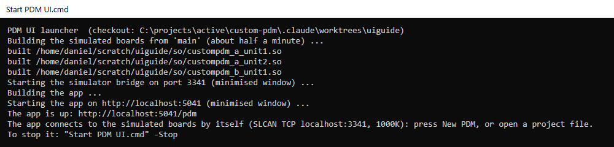

(This picture is from a test copy on port 5041; yours says 5000 and 3333.) To stop it later: run `Start PDM UI.cmd -Stop`.

## 2. Connect

With the simulator the tool connects by itself. The **Adapter** button at the top right shows it.

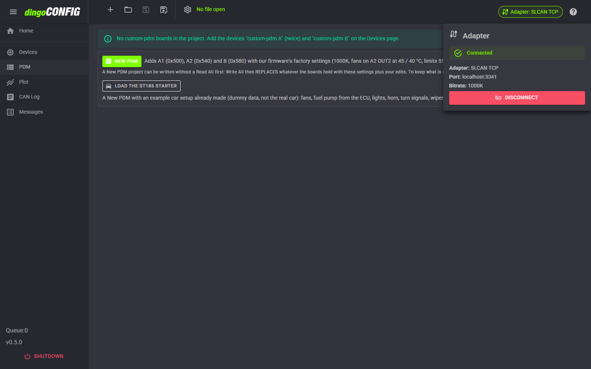

**(real hardware later)** You need a USB-CAN adapter plugged into the PC and wired to the car's CAN bus (X2 cavity 2 =
CAN_H, cavity 3 = CAN_L, `docs/box-connectors.md`). Start the tool with `ui\Start-PdmUi.ps1 -NoSim` (no simulator).
Then click the Adapter button, pick the adapter type, its port, bit rate **1000K**, and **Connect**. The tool remembers
it and connects by itself next time.

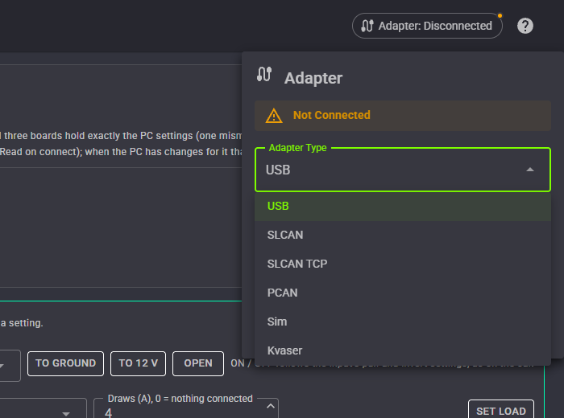

| Adapter type in the list | What it is | Notes |
|---|---|---|
| SLCAN | a USB-CAN adapter with SLCAN firmware (for example CANable, USBtin): shows as a COM port | pick the COM port, 1000K |
| PCAN | PEAK PCAN-USB | needs PEAK's driver; Write All is slower (about 41 s per board instead of 6 s) |
| Kvaser | Kvaser USB adapters (Windows only) | needs Kvaser's driver; Write All slower, as PCAN |
| USB | a dingo board's own USB port | the boards sit inside the sealed box: not reachable in the car |
| SLCAN TCP | the simulator (localhost:3333) | what the shortcut uses today |
| Sim | plays back a saved CAN log | not for setting up |

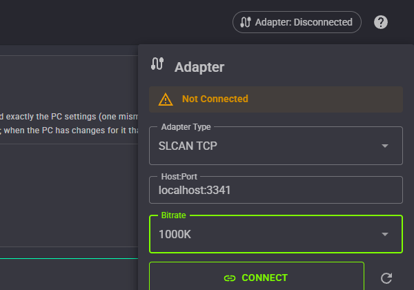

## 3. Start a setup: car config, New PDM or the starter

On an empty PDM page you get three buttons:

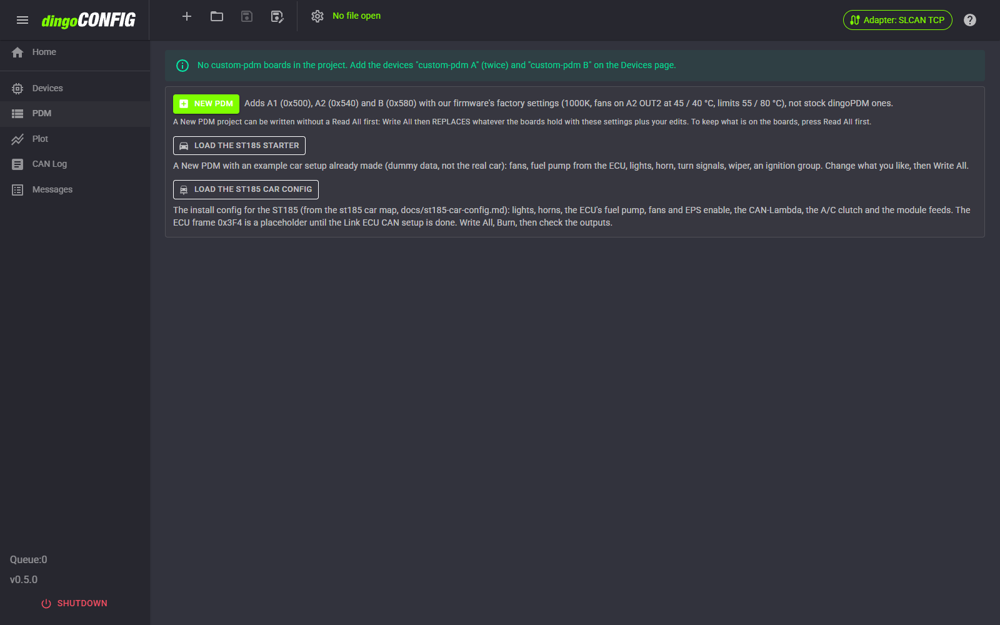

- **Load the ST185 car config**: the settings for YOUR car (`ui/examples/st185-car.json`, explained in
  `docs/st185-car-config.md`). Use this one for the car.
- **New PDM**: three empty boards with our factory settings.
- **Load the ST185 starter**: a demo with fans, fuel pump, lights, horn, turn signals and wiper (not the real car).
  Most pictures below use it.

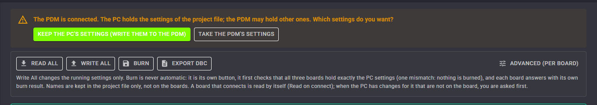

When the PDM is connected, the page asks ONE question: keep the PC's settings or take the PDM's.

- **Keep the PC's settings (write them to the PDM)**: starts Write All at once. Pick this for a new setup.
- **Take the PDM's settings**: reads the boards and throws the file's settings away.

Write All runs board by board (about 6 s each). Each board gets its own result line:

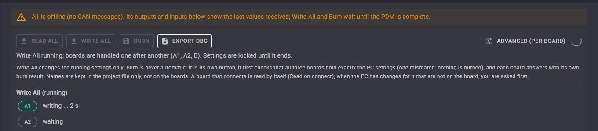
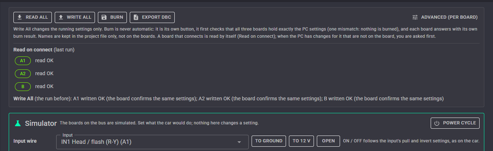

## 4. Name the outputs and inputs

Scroll down to **Outputs (24)** and **Inputs (27)**. Click a name and type a new one (for example "Fog lamps"); tick
**Enabled**. Names live in the project file only (not on the boards), but they show everywhere in the tool and in the
DBC file for the ECU.

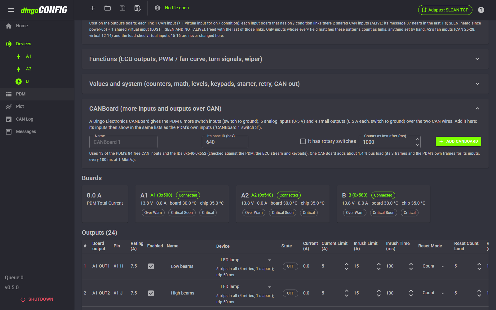
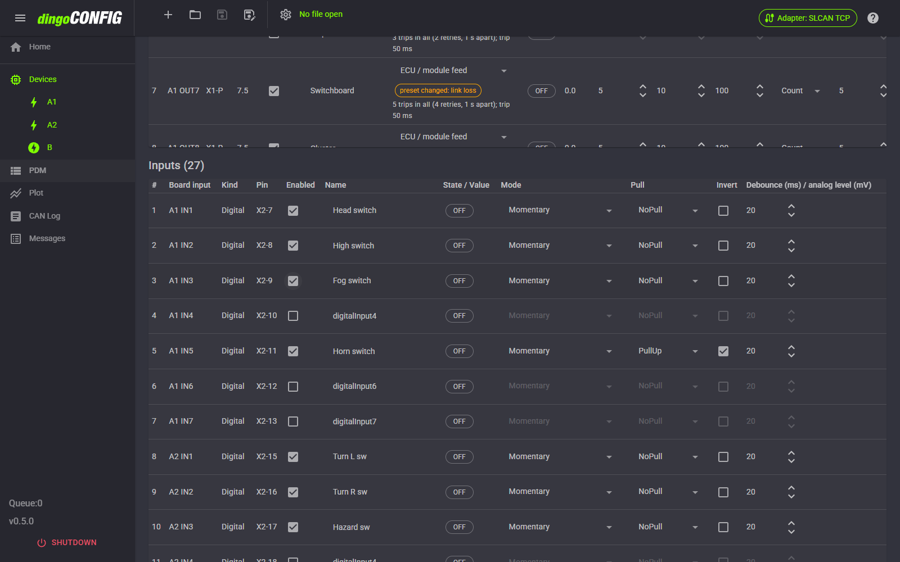

The **Pin** column tells you where the wire goes: X1-K = connector X1, cavity K.

## 5. Pick a device preset for each output

In the **Device** column, pick what is wired to the output (fan, fuel pump, lamp, horn, ...). The tool fills in a safe
current limit, inrush limit and time, trip time and retries for that kind of load. You can still change each number.

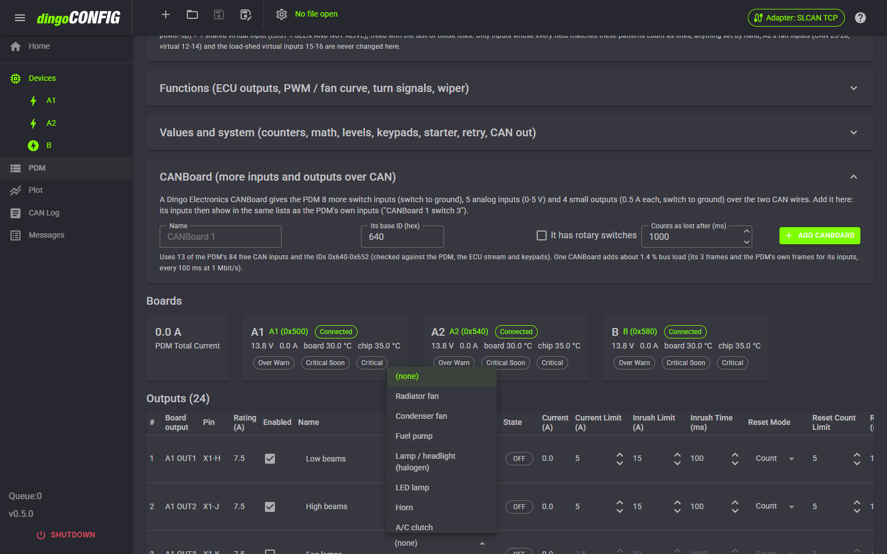
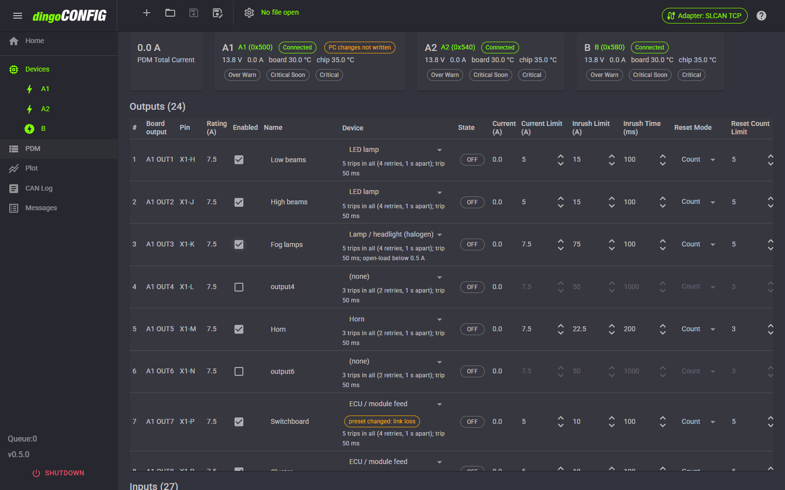

## 6. Say what switches each output (triggers)

**Output triggers** lists all 24 outputs and, in words, what switches each one. Click **Edit** on a row.

One switch (Fog lamps on the Fog switch):

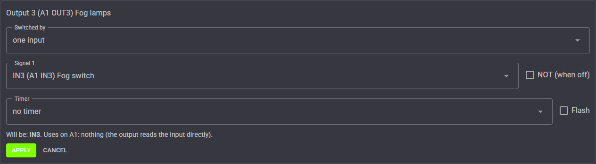

Two things at once (AND: head switch AND ignition). The line under it says what it costs on the board:

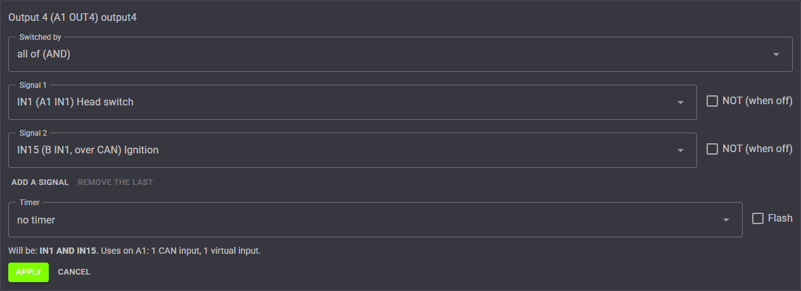

Press **Apply**. Nothing goes to the boards until you press Write All.

The **Functions** panel (click to open it) has the rest:

- **Outputs switched by the ECU**: pick the output, the frame ID (0x3F4), the byte, and what happens if the ECU goes
  quiet (off / keep / on). Press **Set**.

  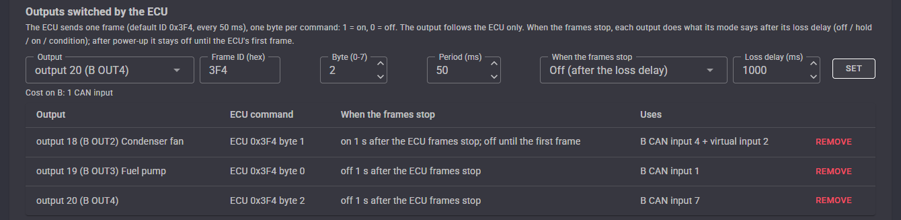

- **CAN values**: a number the ECU sends (coolant temperature, RPM): frame ID, first byte, bits, factor.

  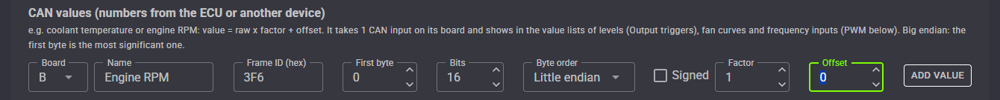

- **PWM / fan curve**: for a fan, pick "Curve of a value", the coolant value, and points `temperature:duty %`
  (for example `85:20, 92.5:55, 97:82, 105:100`). The trigger still says WHEN the fan may run; the curve says how fast.

  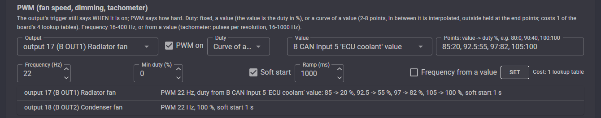

- **Turn signals and hazards**: the left and right lamp outputs, the left / right / hazard switches. One flasher drives
  both sides, so they flash together. **Wiper**: motor output, high-speed output, the switches and the park cam.

  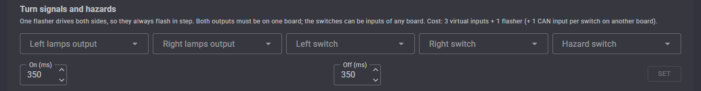
  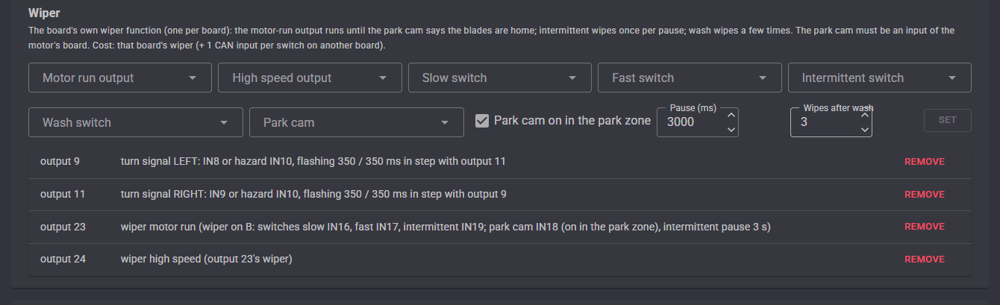

## 7. Temperature limits

Open **PDM settings**. **Board temperature limits** takes ONE set for the whole PDM (the hottest point of the board);
the table shows what each board's sensor will use. Board A keeps its own limits (no heat model yet).

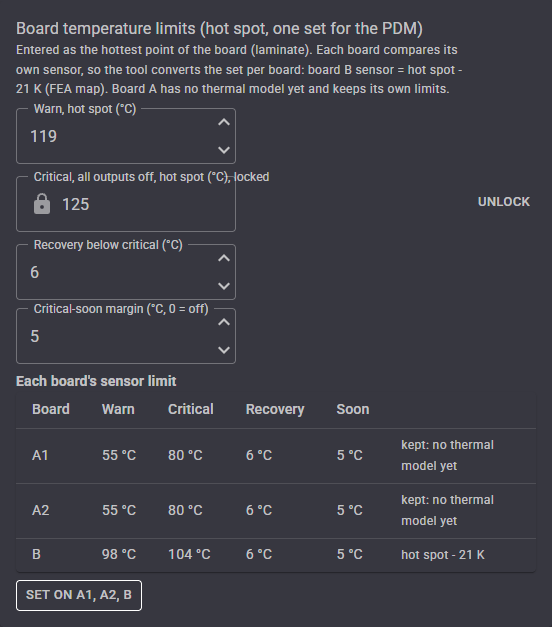

The critical temperature, the CAN bit rate, the base IDs and the "outputs kept on at critical temperature" are
**locked**. To change one: **Unlock**, type the new value twice, **Change**.

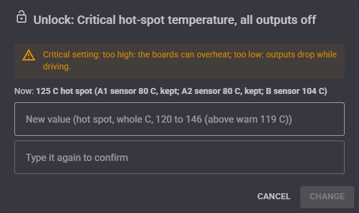

## 8. Write All

Press **Write All** at the top of the PDM page. Wait until A1, A2 and B all say "written OK".

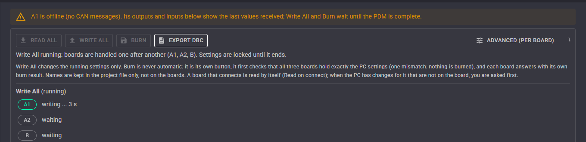
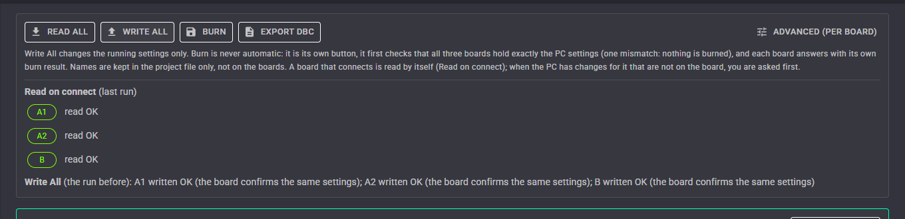

## 9. Faults and Reset faults

When an output trips (too much current, too many times), a red line at the top says which one, in words. Fix the cause,
then press **Reset faults** (nothing is burned). An output that is still overloaded trips again.

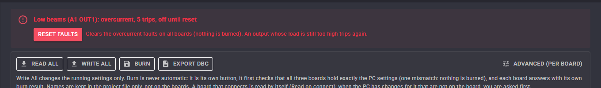
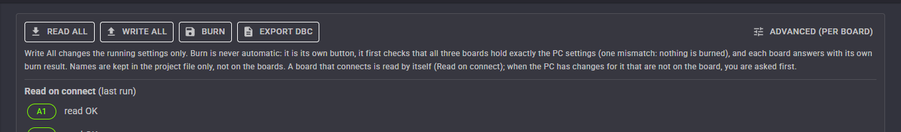

## 10. Burn

Press **Burn**. It first checks that all three boards hold exactly the PC settings (one difference: nothing is burned),
then each board answers.

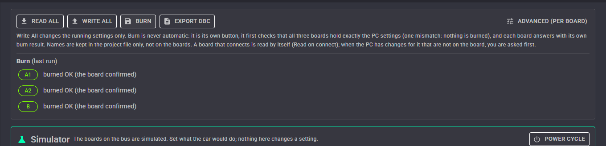

## 11. Save the project file

Click the **Save As** icon (fourth icon at the top). Type a name and **Save** (Quick Save puts it in
Documents\dingoConfig). Open it again later with the folder icon.

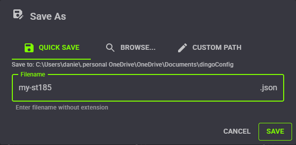

## 12. Export the DBC file for the ECU

Press **Export DBC**. Your browser downloads `custompdm_PDM.dbc`: every PDM message and signal, with your names
(for example `Fog_lamps_Current`). Give it to the ECU setup (PCLink).

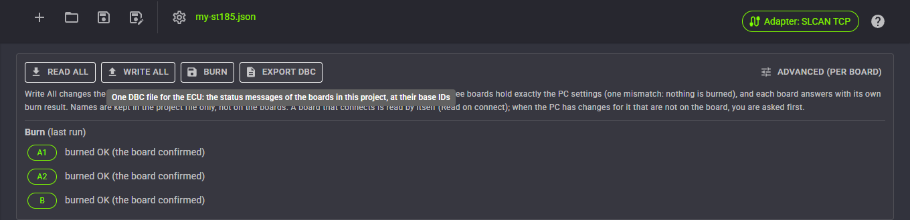

## 13. In the car (real hardware later)

1. Wire the box (`docs/box-connectors.md`, `docs/st185-car-config.md` "Install in the car"). Set the input-board DIP switches.
2. Plug the USB-CAN adapter into the car's CAN bus, key on, start the tool with `-NoSim`, connect (step 2, 1000K).
3. On the empty PDM page press **Load the ST185 car config**, answer **Keep the PC's settings** (Write All runs).
   Wait for "written OK" on A1, A2 and B.
4. Press **Burn**.
5. Power cycle the PDM. The PDM page reads the boards by itself: the Output triggers list must show the same triggers.
6. Check each output. With real boards there is no Simulator panel: work each real switch (head lamps, horn, ...) and
   watch the **State** and **Current** columns and the fault line. To check one output's wiring without its switch, use
   the **Output test** (step 14).

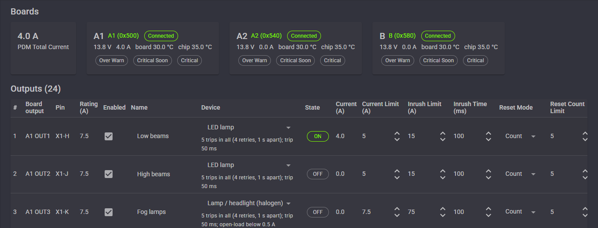

## 14. Output test: one output on for a few seconds (real hardware)

On the PDM page open **Output test**. Pick the output and the time (0.5 to 10 s; 2 s to start with), then press
**Switch on for 2 s**. The output goes on whatever its trigger says, the line under it shows its current (now and peak),
then the board gets its own settings back by itself. **Stop** ends it early. Nothing is burned: a power cycle brings the
burned settings back too.

- An output that runs the fuel pump, EPS / power steering or the starter (by its device preset or its name) needs a
  tick first: "I checked that it is safe to switch it on now".
- Read All, Write All and Burn wait while a test runs, and the test waits while one of them runs. The test is also off
  while the PC holds changes for that board that are not on it yet (Write All first).
- If the adapter or the board goes away during a test, the tool sends the old settings as soon as it is back (the top of
  the page says so until then). Closing the app or pressing Disconnect sends them first.

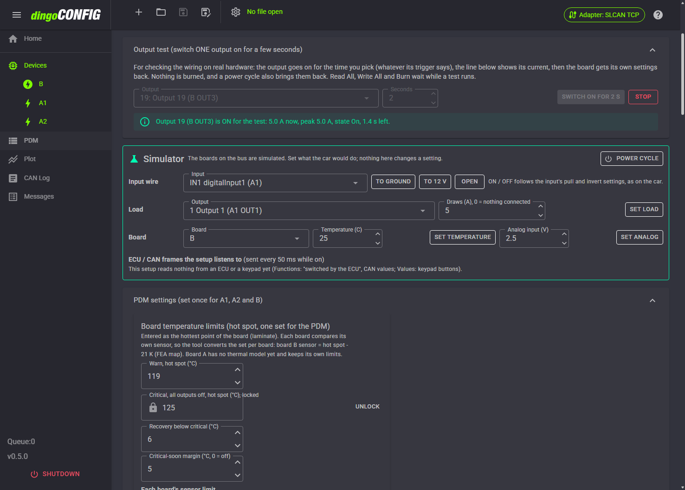

(Picture: output 19 = B OUT3 with a 5 A load on the simulated boards, test copy on port 5044.)

## Problems found while writing this guide

All four were fixed after this guide was written (job uifix2, 2026-11-23):

- A red "Error processing RX frame: 505" popped up once when the starter was loaded while the boards were talking: a
  stock dingoConfig thread race (a CAN frame read while the device list was being replaced). Fixed: the device list can
  be read while it changes (a stress test showed the error first).
- File > Open: typing a full path in the Browse tab and pressing Enter only selected the file. Now Enter opens it.
- During Write All a board briefly showed "offline" at the top. Now the board the run is handling is not said to be
  offline (its card says "Writing"); "read on connect" may still read it again after the write (harmless).
- There was no output test for real hardware. Now there is (step 14).

## How the one-PDM feel is protected

Job uiguide tried to make the three boards stop acting as one PDM, through every page of the app, on the simulated
boards. "Broke it" means it went through before this job; each one is now a test in `OnePdmGuardTests` and fixed in
`ui/dingoConfig/domain/CustomPdm/PdmIntegrity.cs` (rules 1-4) and `CustomPdmGuards.PerBoardOpReason`.

| # | Attempt (page) | Before | Now |
|---|---|---|---|
| 1 | Move A2's base ID onto A1's IDs (/pdm, Unlock to move, 0x510) | blocked: "A2 0x510-0x537 would overlap A1", Change stays off | blocked |
| 2 | Type a new critical temperature / bit rate on /pdm without the dialog | blocked: fields locked (padlock) | blocked |
| 3 | Change A2 CAN input 25 (fan logic, reserved) on /pdm/advanced | warned: "already assigned to the fan logic. Overwrite?"; Cancel put 0x502 back | warned |
| 4 | Change A2's CAN bit rate on /pdm/advanced | blocked: "critical settings change only on the PDM page" | blocked |
| 5 | Modify a board's base ID on /devices | blocked: the Base ID field is read-only for custom-pdm boards | blocked |
| 6 | Add a stock "dingoPDM" device at 0x500 on /devices, then its Write All | **broke it**: stock settings (500K) written onto A1 ("dingoPDM: Write Successful"); its Burn, Bootloader, Sleep, Modify also go to A1 | fixed: the PC sends nothing to either device (log line says why), /pdm shows the clash and Read All / Write All / Burn are off until the extra device is deleted |
| 7 | A board's own device page: per-board Write All / Burn | **broke it**: one board burned alone, without the "all three hold the PC settings" check | fixed: both off there, chip "Write All / Burn: PDM page" |
| 8 | File > Open of an edited file: A2 on A1's base ID (or overlapping, 0x510) | **broke it**: no warning; Write All wrote 0x500 twice, then read on connect copied A1 into the PC's A2 | fixed: clash shown, nothing read, written or burned |
| 9 | File > Open of an edited file: A1 and A2 base IDs swapped | **broke it**: A2's settings (fan logic on OUT2) written onto board A1, A1's onto A2 | fixed: "A1 CAN input 25 listens to 0x502, inside its own ID block ... swapped?" Write All / Burn off; Take the PDM's settings is the way out |
| 10 | File > Open of an edited file: A2 on 500K | **broke it**: written without the Unlock dialog (A2 would go silent after Burn) | fixed: "CAN bit rate differs" and "from the project file ... not set with Unlock": Write All / Burn off until Unlock or Take the PDM's settings |
| 11 | File > Open of an edited file: critical temperature / outputs kept on at critical changed | **broke it** (same path as 10; proven in tests) | fixed: same rule; board A's temperature only back to factory. A file saved by the app carries a seal of these values, so your own saved setups load without questions |
| 12 | Two browser tabs: both trigger editors open on A2 at once (A2 OUT3 = IN8 AND IN9, A2 OUT4 = IN8 AND IN10), Apply in one tab, then the other | blocked: each Apply plans on the current settings: A2 virtual inputs 1 and 2, nothing shared, both triggers read back right (the engine still lists IN8-10 as not enabled, true in the car config) | blocked |
| 13 | Write All with one board missing (sim `LINK A2 off`) | blocked: "A2 is offline" at the top, "Write All and Burn are off: A2: offline." | blocked |
| 14 | Delete A1 on /devices | **broke it**: the remaining A board (0x540) was LABELLED A1 (outputs 1-8, X1-H..R pins), so edits meant for A1 landed on it | fixed (uifix2): a lone A board is shown as "A? (0x540)", not numbered; the setting panels are hidden and the grids read-only until the PDM has its three boards or you press "This is A1" / "This is A2". A New PDM board keeps its factory role |
| 15 | Stock menus: CAN Log, Plot, Messages | blocked: they only show frames / signals (CAN Log: Clear, Log to file; Plot: Signals, Record); nothing can be sent from them | blocked |

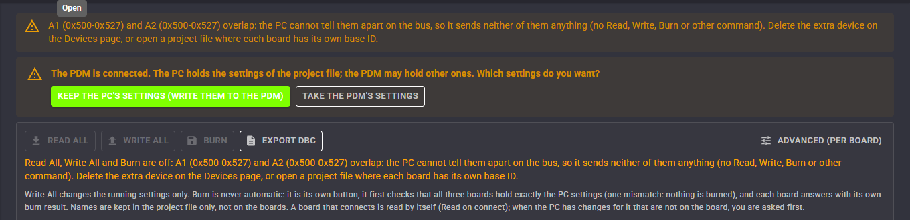
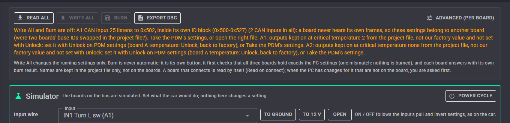
Rows 6 and 7 after the fix are proven by `OnePdmGuardTests` (a real DeviceManager on stand-in boards: no frame reaches A1); a browser picture of them was not taken.
